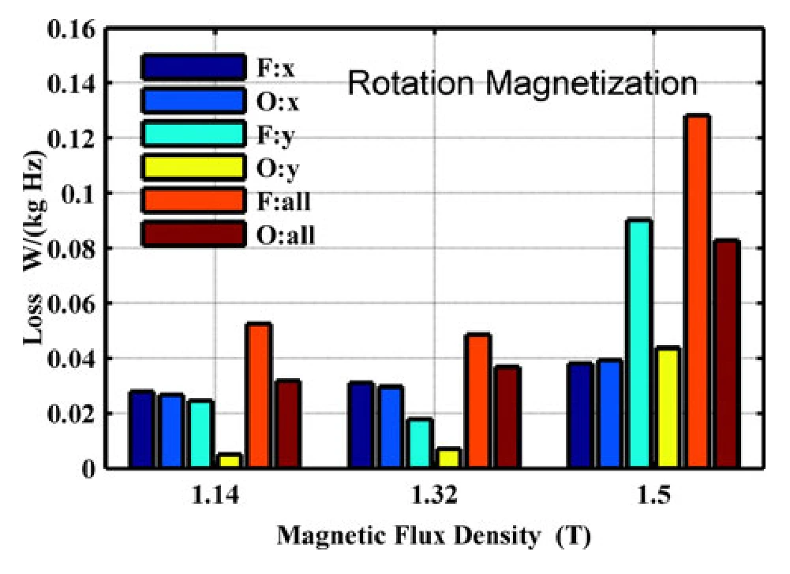

**作者**　张长庚、李永建、李劲松、杨庆新、朱建国 
**期刊**　《IEEE 工业电子学汇刊》，第 64 卷第 3 期，第 2476–2485 页 
**首次在线发表**　2016 年 8 月 2 日 
**刊期**　2017 年 3 月，第 64 卷第 3 期 
**DOI**　`10.1109/TIE.2016.2597118`

<a href="/assets/papers/2017/three-dimensional-magnetic-measurement-with-harmonic-compensation.pdf" download="three-dimensional-magnetic-measurement-with-harmonic-compensation.pdf">下载论文全文（PDF）</a> · 10 页 · 1.0 MB

## 研究简介

电工钢接近深度饱和时，多轴磁化轨迹更难控制。团队将频域反馈、谐波补偿与正反向旋转测量结合，减小波形失真和测量线圈引入的偏差，改善旋转损耗测量。

## 摘要

旋转电机和三相电力变压器的 T 形接缝处存在三维磁通，可能引起局部过热。本文利用改进的三维磁特性测量装置测量铁心材料的三维磁特性。首先通过电压与磁链方程建立三维磁化系统模型，通过有限元分析与实验确定自感、互感和非线性阻抗等参数。其次提出频域磁反馈方法，以获得所需的磁化轨迹。试样深度磁饱和时，磁通密度波形中的谐波会影响相应磁场强度轨迹的形状及损耗计算的精度，因此提出波形补偿方法消除谐波影响。通过对顺时针与逆时针旋转实验结果取平均，消除 H 线圈的张量效应。最终研制了具备反馈控制、谐波补偿和自动数据处理功能的三维测量系统。在不同激磁模式下对无取向硅钢片开展测试，采用反馈与谐波补偿得到的结果更为可靠。

<figure style="margin:1.5rem 0">
  
  <figcaption>图 12　采用反馈控制与原有测量方法得到的单周期旋转磁化损耗对比。 <a href="/assets/papers/2017/three-dimensional-magnetic-measurement-with-harmonic-compensation.pdf#page=7">图片所在页</a></figcaption>
</figure>

[英文版](/2016/08/02/three-dimensional-magnetic-measurement-with-harmonic-compensation) · [返回团队新闻](/team-news/)
