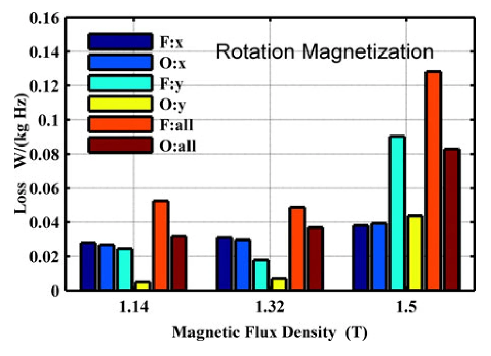

**Authors**　Changgeng Zhang, Yongjian Li, Jingsong Li, Qingxin Yang, Jianguo Zhu 
**Journal**　IEEE Transactions on Industrial Electronics 64(3), 2476–2485 (2017) 
**First published online**　2 August 2016 
**Journal issue**　March 2017, volume 64, issue 3 
**DOI**　`10.1109/TIE.2016.2597118`

<a href="/assets/papers/2017/three-dimensional-magnetic-measurement-with-harmonic-compensation.pdf" download="three-dimensional-magnetic-measurement-with-harmonic-compensation.pdf">Download full paper (PDF)</a> · 10 pages · 1.0 MB

## Research brief

Deep saturation makes the flux trajectory hard to control when electrical steel is magnetized along several axes. The authors combined frequency-domain feedback, harmonic compensation and paired clockwise and counterclockwise tests to obtain more reliable rotational-loss measurements.

## Abstract

Three-dimensional (3-D) magnetic fluxes exist in rotating electric machines and T-joints of three-phase power transformers, and may cause local overheating in these devices. In this paper, 3-D magnetic properties of the core materials are measured by an improved 3-D magnetic property tester. First, the 3-D magnetization system is modeled by the voltage and flux linkage equations. Their parameters including the self and mutual inductances and nonlinear impedance are analyzed by the finite element analysis and measured by experiments. Second, a magnetic feedback method in the frequency domain is proposed to obtain the desired magnetization loci. Third, when the specimen is in deep magnetic saturation, the harmonics of magnetic flux density waveform would affect the shape of the corresponding magnetic field strength loci and the accuracy of loss computation. Thus, a waveform compensation method is proposed to eliminate the effects of harmonics. Fourth, the tensor effects of H coils are eliminated by averaging the results of clockwise and counterclockwise rotational experiments. Finally, the 3-D magnetic test system with feedback control, harmonics compensation, and automated data processing is developed. By using the 3-D magnetic tester, samples of nonoriented silicon sheet steel are measured with various excitation models and the results are more reliable than those obtained by experiments without feedback and harmonics compensation.

<figure style="margin:1.5rem 0">
  
  <figcaption>Figure 12. Rotational magnetization loss per cycle measured with feedback and with the original method. <a href="/assets/papers/2017/three-dimensional-magnetic-measurement-with-harmonic-compensation.pdf#page=7">Figure in the full paper</a></figcaption>
</figure>

[Chinese edition](/zh/news/three-dimensional-magnetic-measurement-with-harmonic-compensation/) · [News of My Group](/categories)
