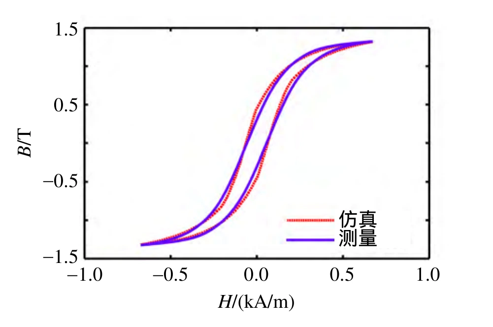

**作者**　张长庚、李永建、杨庆新 
**期刊**　《中国电机工程学报》，第 36 卷第 21 期，第 5966–5974、6041 页 
**刊出日期**　2016 年 11 月 5 日 
**DOI**　`10.13334/j.0258-8013.pcsee.160221`

<a href="/assets/papers/2016/electromagnetic-simulation-with-hysteresis-and-micro-eddy-currents.pdf" download="electromagnetic-simulation-with-hysteresis-and-micro-eddy-currents.pdf">下载论文全文（PDF）</a> · 10 页 · 0.7 MB

## 研究简介

将硅钢叠片等效为实心材料可以减少网格量，也会掩盖微观涡流的作用。团队将逆 Preisach 模型与电磁场方程耦合，并用 35WW270 无取向硅钢片的交变及旋转磁化实验检验计算结果。

## 摘要

电机和电力变压器电磁仿真以实心材料代替硅钢叠片铁心，难以准确描述涡流路径，并且忽略了涡流效应影响。该文提出了一种考虑微观涡流和磁滞的电磁模拟算法。通过一阶回转曲线计算磁滞过程的 Everett 函数，从而辨识逆 Preisach 模型的参数，并对微观涡流损耗系数进行优化拟合；构建考虑微观涡流和磁滞效应的电磁本构方程，设计有限元离散和方程组迭代的算法，实现 Maxwell 方程、磁滞和微观涡流场的耦合。最后，对无取向钢片 35WW270 进行了交变一维磁特性和旋转二维磁特性的实验。为了验证数值算法的有效性，三维磁特性测量装置简化为二维模型进行电磁有限元仿真，仿真结果与交变和旋转磁特性测量结果吻合较好，验证了叠片铁心微观涡流算法的正确性和有效性。

<figure style="margin:1.5rem 0">
  
  <figcaption>图 12　无取向硅钢片在 50 Hz 下磁特性的仿真与测量结果。 <a href="/assets/papers/2016/electromagnetic-simulation-with-hysteresis-and-micro-eddy-currents.pdf#page=7">图片所在页</a></figcaption>
</figure>

[英文版](/2016/11/05/electromagnetic-simulation-with-hysteresis-and-micro-eddy-currents) · [返回团队新闻](/team-news/)
