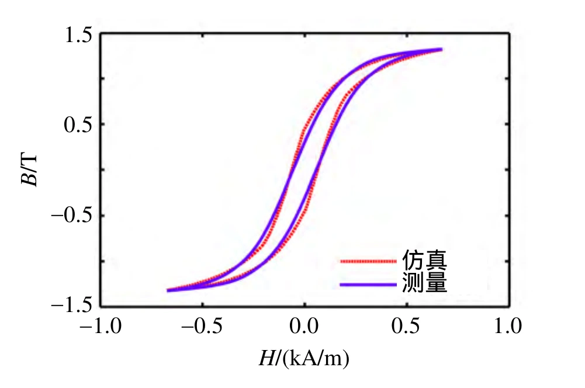

**Authors**　Changgeng Zhang, Yongjian Li, Qingxin Yang 
**Journal**　Proceedings of the CSEE 36(21), 5966–5974, 6041 (2016) 
**Issue publication date**　5 November 2016 
**DOI**　`10.13334/j.0258-8013.pcsee.160221`

<a href="/assets/papers/2016/electromagnetic-simulation-with-hysteresis-and-micro-eddy-currents.pdf" download="electromagnetic-simulation-with-hysteresis-and-micro-eddy-currents.pdf">Download full paper (PDF)</a> · 10 pages · 0.7 MB

## Research brief

Treating laminated steel as a solid core simplifies the mesh but obscures microscopic eddy currents. The researchers coupled an inverse Preisach model to the field equations and tested it against alternating and rotating magnetization measurements on 35WW270 steel.

## Abstract

In the simulation of motor and power transformer, the silicon laminated core is regarded as the bulk material avoiding the huge triangulation and computation. This simplification can not describe the eddy current path and ignore the influence of the eddy current. The magnetic field equation considering the micro-eddy current and magnetic hysteresis was proposed. Firstly, the inverse Preisach hysteresis model was identified by the measurement data and the inverse Everett function was computed from first order recursive curve. And the micro-eddy current loss coefficients were optimized fitting. Secondly, the controlled electromagnetic equation was proposed to couple with the Maxwell equation, Preisach model and micro eddy current. Lastly, the alternating and rotational magnetic properties of the non-oriented silicon steel 35WW270 were measured. In order to verify the validity of the numerical algorithm, the electromagnetic finite element method (FEM) simulation was fulfilled by means of the simplified 2D model from the 3D magnetic tester. Simulation results are in agreement with the experimental results, which can prove the correctness and validity of this micro-eddy current algorithm.

<figure style="margin:1.5rem 0">
  
  <figcaption>Figure 12. Simulated and measured magnetic response of non-oriented silicon steel at 50 Hz. <a href="/assets/papers/2016/electromagnetic-simulation-with-hysteresis-and-micro-eddy-currents.pdf#page=7">Figure in the full paper</a></figcaption>
</figure>

[Chinese edition](/zh/news/electromagnetic-simulation-with-hysteresis-and-micro-eddy-currents/) · [News of My Group](/categories)
