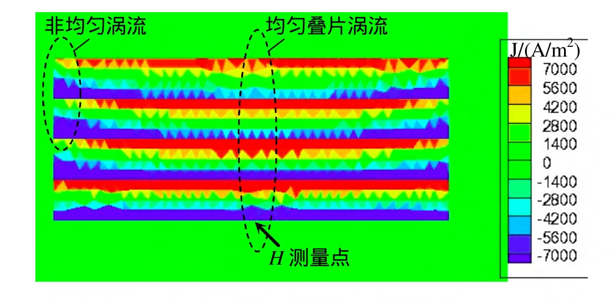

**作者**　张长庚、杨庆新、李永建 
**期刊**　《中国电机工程学报》，第 37 卷第 7 期，第 2167–2175 页 
**刊出日期**　2017 年 4 月 5 日 
**DOI**　`10.13334/j.0258-8013.pcsee.160222`

<a href="/assets/papers/2017/broadband-three-axis-modeling-of-laminated-silicon-steel.pdf" download="broadband-three-axis-modeling-of-laminated-silicon-steel.pdf">下载论文全文（PDF）</a> · 10 页 · 0.7 MB

## 研究简介

团队用三轴正交测量装置在 20 Hz 至 1 kHz 范围内检验硅钢叠片模型。弱磁场下采用线性涡流解析模型，强磁场下用非线性有限元法区分片内的多个涡流区域，并将计算结果与实测磁化曲线对照。

## 摘要

针对硅钢叠片的工作磁通频率高于工频时磁特性计算不准确的问题，开展了宽频(20 Hz～1 kHz)激磁条件下的磁特性测量和建模。建立了硅钢叠片的线性涡流场解析模型，该模型在低磁场激励下有效预测硅钢片宽频磁特性；在高磁场激励下，提出一种考虑多涡流域和非线性的瞬态电磁有限元方法。该方法模拟了二维硅钢片材料，隔离了叠片铁心二维平面内多个涡流区域，计算了硅钢叠片的宽频磁化曲线。最后，利用三轴正交磁特性测量装置对硅钢叠片进行综合磁特性实验。比较实验结果与数值模拟结果验证算法的有效性。

<figure style="margin:1.5rem 0">
  
  <figcaption>图 13　平行于叠片方向激磁时四片硅钢片中的涡流分布。 <a href="/assets/papers/2017/broadband-three-axis-modeling-of-laminated-silicon-steel.pdf#page=8">图片所在页</a></figcaption>
</figure>

[英文版](/2017/04/05/broadband-three-axis-modeling-of-laminated-silicon-steel) · [返回团队新闻](/team-news/)
