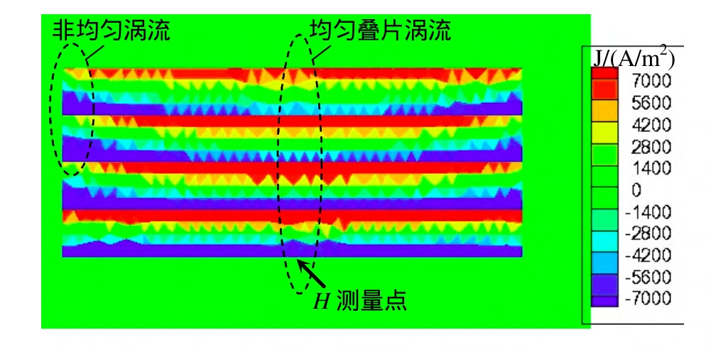

**Authors**　Changgeng Zhang, Qingxin Yang, Yongjian Li 
**Journal**　Proceedings of the CSEE 37(7), 2167–2175 (2017) 
**Issue publication date**　5 April 2017 
**DOI**　`10.13334/j.0258-8013.pcsee.160222`

<a href="/assets/papers/2017/broadband-three-axis-modeling-of-laminated-silicon-steel.pdf" download="broadband-three-axis-modeling-of-laminated-silicon-steel.pdf">Download full paper (PDF)</a> · 10 pages · 0.7 MB

## Research brief

Measurements from 20 Hz to 1 kHz provided a test for two descriptions of laminated steel. A linear analytical model reproduced weak-field behavior, while a nonlinear finite element model separated the eddy-current paths at stronger fields.

## Abstract

Laminated silicon steel can not be simulated accurately when the working frequency is higher than 50Hz. In order to solve this problem, magnetic properties of the laminated silicon steel were measured and modeled at broad frequency range (20Hz~1kHz). Firstly, a linear eddy current field analytical model was built for effectively predicting broad frequency range magnetic properties of the laminated silicon steel at low magnetic field. Secondly, a transient electromagnetic finite element method considering the eddy current effect in multi-domain and nonlinearity was proposed for 2-D magnetic modeling of silicon steel at high magnetic field. This method can separate the laminated magnetic core into multi-domain with eddy effect and compute its magnetization curve at broad frequency. At last, by using a three axes orthogonal magnetic tester, comprehensive magnetic properties of the laminated silicon steel were measured. By comparing the measured and simulated results, the validity of the proposed method can be verified.

<figure style="margin:1.5rem 0">
  
  <figcaption>Figure 13. Distribution of eddy currents in four steel sheets under in-plane excitation. <a href="/assets/papers/2017/broadband-three-axis-modeling-of-laminated-silicon-steel.pdf#page=8">Figure in the full paper</a></figcaption>
</figure>

[Chinese edition](/zh/news/broadband-three-axis-modeling-of-laminated-silicon-steel/) · [News of My Group](/categories)
