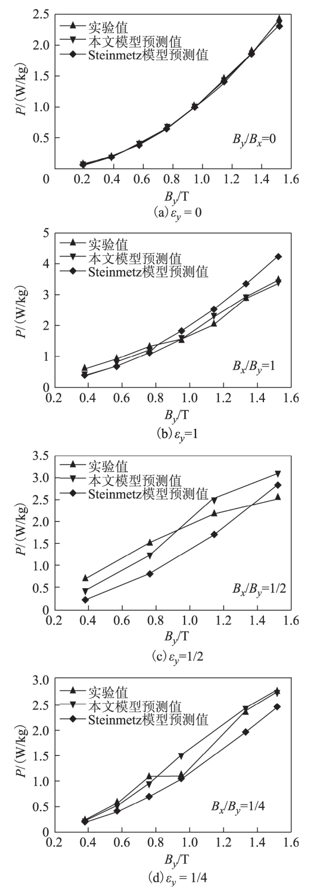

**作者**　张长庚、杨庆新、李永建 
**期刊**　《电工技术学报》，第 32 卷第 11 期，第 208–216 页 
**文章发表日期**　2017 年 6 月 20 日 
**所在期次出版日期**　2017 年 6 月 10 日

<a href="/assets/papers/2017/rotational-hysteresis-loss-in-soft-magnetic-materials.pdf" download="rotational-hysteresis-loss-in-soft-magnetic-materials.pdf">下载论文全文（PDF）</a> · 9 页 · 2.3 MB

## 研究简介

电机或变压器铁心中的旋转磁通可以沿不同轴比的椭圆轨迹变化。团队把磁滞损耗分为切向和法向分量，通过四种励磁模式的实测结果检验模型对复杂轨迹的预测能力。

## 摘要

电力变压器和电机中存在旋转铁心损耗是其损耗预测不准的主要原因之一。针对该问题，提出电工软磁材料旋转磁滞损耗测量及建模方法。首先，矢量磁滞损耗分解为切向损耗和法向损耗两部分，分别根据圆形旋转损耗和交变损耗建模。其次，对软磁复合材料和无取向电工钢片进行模型参数辨识，并比较两种材料的损耗特性和模型参数。最后，利用三维磁特性测量装置进行多种励磁模式下的损耗测量，并对比实验结果与模型预测值。结果表明，在旋转复杂激励下，所提出的模型比传统的 Steinmetz 模型有更高的精度。

<figure style="margin:1.5rem 0">
  
  <figcaption>图 9　四种励磁模式下损耗模型预测值与实验值对比。 <a href="/assets/papers/2017/rotational-hysteresis-loss-in-soft-magnetic-materials.pdf#page=7">图片所在页</a></figcaption>
</figure>

[英文版](/2017/06/rotational-hysteresis-loss-in-soft-magnetic-materials) · [返回团队新闻](/team-news/)
