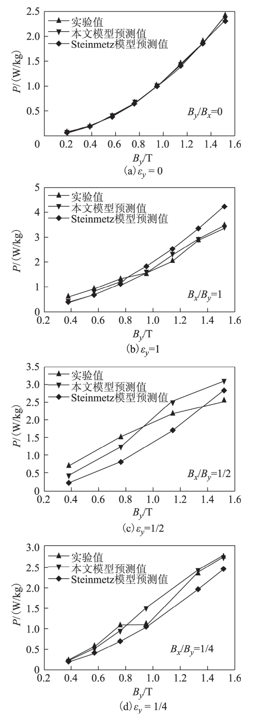

**Authors**　Changgeng Zhang, Qingxin Yang, Yongjian Li 
**Journal**　Transactions of China Electrotechnical Society 32(11), 208–216 (2017) 
**Article publication date**　20 June 2017 
**Journal issue date**　10 June 2017

<a href="/assets/papers/2017/rotational-hysteresis-loss-in-soft-magnetic-materials.pdf" download="rotational-hysteresis-loss-in-soft-magnetic-materials.pdf">Download full paper (PDF)</a> · 9 pages · 2.3 MB

## Research brief

Rotating flux in a motor or transformer can follow an ellipse whose axes change during a cycle. The researchers separated tangential and radial contributions to hysteresis loss and compared the resulting predictions with measurements under four excitation patterns.

## Abstract

The rotational flux in the core of power transformer and motor causes the inaccuracy efficiency computation of magnetic apparatus. In order to address the problem, this work focuses on magnetic measurement of rotational magnetization and its hysteresis loss modeling. Firstly, the vector hysteresis loss is decomposed into the transverse and radial components which are defined based on rotational loss and alternating loss, respectively. Secondly, the model parameters of soft magnetic composites and non-oriented silicon steel are identified. Their magnetic properties and model parameters are compared and analyzed. Finally, a series of complex excitation magnetization experiments on non-oriented silicon steel are carried out. The measurement results are compared with the predicted values by the model. It shows that the proposed model gives more exact predicted results than the traditional Steinmetz method.

<figure style="margin:1.5rem 0">
  
  <figcaption>Figure 9. Model predictions and measured losses for four excitation patterns. <a href="/assets/papers/2017/rotational-hysteresis-loss-in-soft-magnetic-materials.pdf#page=7">Figure in the full paper</a></figcaption>
</figure>

[Chinese edition](/zh/news/rotational-hysteresis-loss-in-soft-magnetic-materials/) · [News of My Group](/categories)
