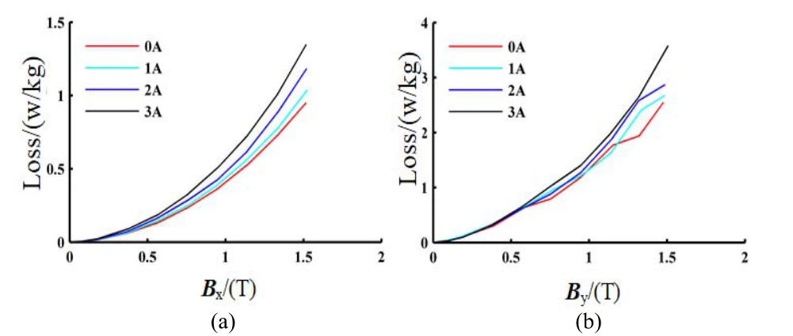

**作者**　张长庚、闫鑫笑、李永建、杨庆新 
**期刊**　《IEEE 磁学汇刊》，第 55 卷第 2 期，文章编号 8000204 
**首次在线发表**　2018 年 9 月 26 日 
**刊期**　2019 年 2 月，第 55 卷第 2 期 
**DOI**　`10.1109/TMAG.2018.2868883`

<a href="/assets/papers/2019/vector-magnetic-properties-of-steel-under-stacking-direction-bias.pdf" download="vector-magnetic-properties-of-steel-under-stacking-direction-bias.pdf">下载论文全文（PDF）</a> · 4 页 · 1.0 MB

## 研究简介

当静磁场沿硅钢叠片厚度方向施加时，片内磁化也会受影响。研究团队用表面传感线圈测量了取向硅钢在这种偏置下的动态响应，并用所得结果辨识各向异性模型参数。

## 摘要

硅钢叠片平面内的旋转磁通所引起的铁损远高于交变磁通。爱泼斯坦方圈等传统装置仅沿一个方向测量，可能导致铁损预测不准确。本文研制了三维磁特性测量装置，用于测量高取向硅钢的磁特性。通过自动控制系统与新型表面 B–H 传感线圈，在沿试样叠压方向施加静磁场的条件下，准确测量硅钢片的动态磁滞特性。最后建立椭球磁各向异性模型，其参数可通过偏置磁场下的磁特性测量结果辨识。

<figure style="margin:1.5rem 0">
  
  <figcaption>图 7　不同叠压方向直流偏置下，沿轧制方向和横向测得的铁损。 <a href="/assets/papers/2019/vector-magnetic-properties-of-steel-under-stacking-direction-bias.pdf#page=3">图片所在页</a></figcaption>
</figure>

[英文版](/2018/09/26/vector-magnetic-properties-of-steel-under-stacking-direction-bias) · [返回团队新闻](/team-news/)
