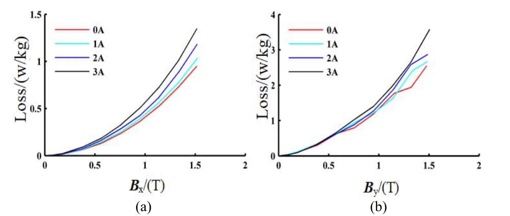

**Authors**　Changgeng Zhang, Xinxiao Yan, Yongjian Li, Qingxin Yang 
**Journal**　IEEE Transactions on Magnetics 55(2), 8000204 (2019) 
**First published online**　26 September 2018 
**Journal issue**　February 2019, volume 55, issue 2 
**DOI**　`10.1109/TMAG.2018.2868883`

<a href="/assets/papers/2019/vector-magnetic-properties-of-steel-under-stacking-direction-bias.pdf" download="vector-magnetic-properties-of-steel-under-stacking-direction-bias.pdf">Download full paper (PDF)</a> · 4 pages · 1.0 MB

## Research brief

A static magnetic field through a stack of electrical steel changes the in-plane response. Surface sensing coils allowed the team to measure this interaction in grain-oriented steel and use the observations to identify an anisotropic material model.

## Abstract

Rotational magnetic flux in the plane of steel laminations causes core losses which far exceed than alternating magnetic flux. Traditional testing methods such as Epstein frame detected only in one direction may lead to inaccurate predictions of core losses. This paper developed a 3-D magnetic properties testing device to measure the magnetic properties of high grain-oriented silicon steel. By using the automatic control system and novel surface B–H sensing coils, the dynamic magnetic hysteresis properties of the silicon steel are accurately measured with a static magnetic field along the laminated direction of the specimen. Finally, an ellipsoid magnetic anisotropy model is established which parameters can be identified by the magnetic measurement results with biased magnetic field.

<figure style="margin:1.5rem 0">
  
  <figcaption>Figure 7. Core losses along the rolling and transverse directions under different stacking-direction bias fields. <a href="/assets/papers/2019/vector-magnetic-properties-of-steel-under-stacking-direction-bias.pdf#page=3">Figure in the full paper</a></figcaption>
</figure>

[Chinese edition](/zh/news/vector-magnetic-properties-of-steel-under-stacking-direction-bias/) · [News of My Group](/categories)
