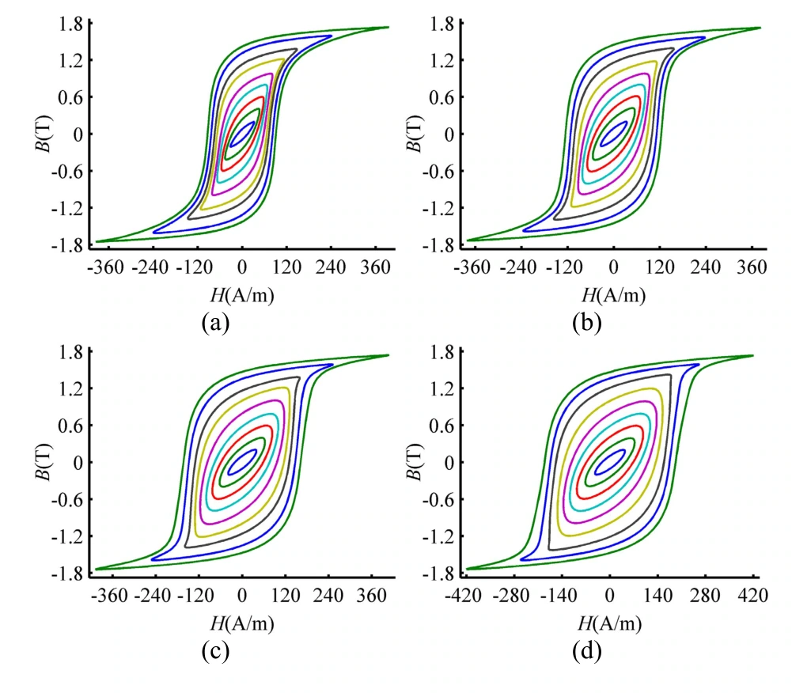

**作者**　陈瑞颖、张长庚、李永建、杨庆新、王利祥 
**期刊**　《IEEE 磁学汇刊》，第 55 卷第 2 期，文章编号 6100404 
**首次在线发表**　2018 年 10 月 25 日 
**刊期**　2019 年 2 月，第 55 卷第 2 期 
**DOI**　`10.1109/TMAG.2018.2868811`

<a href="/assets/papers/2019/double-sheet-testing-of-silicon-steel-at-high-frequency.pdf" download="double-sheet-testing-of-silicon-steel-at-high-frequency.pdf">下载论文全文（PDF）</a> · 4 页 · 1.6 MB

## 研究简介

两张硅钢试片构成对称磁路后，放在试片间隙中的线圈便可测得接近片内的磁场强度。研究团队据此改进了单片磁性能测量仪，装置最高工作频率可达 20 kHz，并测得超薄硅钢片在多种频率下的磁滞回线。

## 摘要

单片磁性能测量仪是测量硅钢磁特性的传统装置。为提高测量精度，本文提出采用双磁轭、双试片的改进型装置。电磁仿真表明，在对称磁路中，两片之间的磁场强度 H 近似等于两张试片内的 H，改进装置具有比传统双磁轭单片装置更高的测量精度。针对测量系统提出一种新的控制方法，以保证磁路的对称性。实验采用感应线圈法分别测量试样的磁场强度 H 和磁通密度 B，装置最高工作频率可达 20 kHz。

<figure style="margin:1.5rem 0">
  
  <figcaption>图 9　超薄硅钢片在四种频率下的实测磁滞回线。 <a href="/assets/papers/2019/double-sheet-testing-of-silicon-steel-at-high-frequency.pdf#page=4">图片所在页</a></figcaption>
</figure>

[英文版](/2018/10/25/double-sheet-testing-of-silicon-steel-at-high-frequency) · [返回团队新闻](/team-news/)
