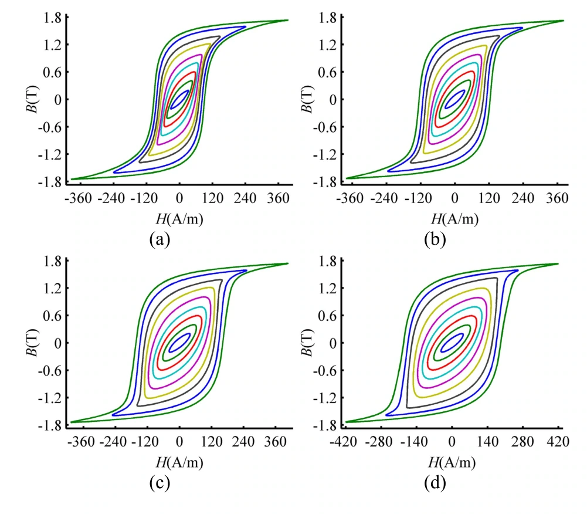

**Authors**　Ruiying Chen, Changgeng Zhang, Yongjian Li, Qingxin Yang, Lixiang Wang 
**Journal**　IEEE Transactions on Magnetics 55(2), 6100404 (2019) 
**First published online**　25 October 2018 
**Journal issue**　February 2019, volume 55, issue 2 
**DOI**　`10.1109/TMAG.2018.2868811`

<a href="/assets/papers/2019/double-sheet-testing-of-silicon-steel-at-high-frequency.pdf" download="double-sheet-testing-of-silicon-steel-at-high-frequency.pdf">Download full paper (PDF)</a> · 4 pages · 1.6 MB

## Research brief

Placing two steel sheets in a symmetric magnetic circuit creates a gap in which a sensing coil can measure a field close to the one inside the steel. The apparatus operated at frequencies up to 20 kHz, and the paper reports hysteresis loops of ultra-thin steel at several test frequencies.

## Abstract

Single sheet tester (SST) is a traditional method for measuring magnetic properties of silicon steel. In order to make the measurement more accurate, this paper presents an improved SST with double yokes and double sheets. The electromagnetic simulation demonstrates that the magnetic field strength H between the two sheets that are in symmetric magnetic path approximately equal to H of two sheets, proving that the improved SST has higher test accuracy than the traditional double-yoked SST. A novel control method is proposed for the measurement system to make sure the symmetry of magnetic path. In this experiment, the magnetic field strength H and the magnetic flux density B of the tested samples are measured by an induction coil method, and the maximum working frequency of this apparatus can be up to 20 kHz.

<figure style="margin:1.5rem 0">
  
  <figcaption>Figure 9. Measured hysteresis loops of ultra-thin silicon steel at four frequencies. <a href="/assets/papers/2019/double-sheet-testing-of-silicon-steel-at-high-frequency.pdf#page=4">Figure in the full paper</a></figcaption>
</figure>

[Chinese edition](/zh/news/double-sheet-testing-of-silicon-steel-at-high-frequency/) · [News of My Group](/categories)
