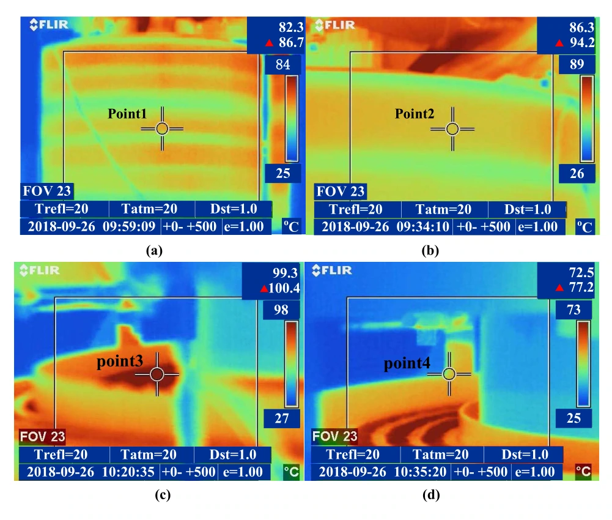

**作者**　李永建、闫鑫笑、王春光、杨庆新、张长庚 
**期刊**　《IEEE 磁学汇刊》，第 55 卷第 7 期，文章编号 8401705 
**首次在线发表**　2019 年 3 月 4 日 
**刊期**　2019 年 7 月，第 55 卷第 7 期 
**DOI**　`10.1109/TMAG.2019.2897503`

<a href="/assets/papers/2019/eddy-current-loss-in-transformer-foil-windings.pdf" download="eddy-current-loss-in-transformer-foil-windings.pdf">下载论文全文（PDF）</a> · 5 页 · 1.6 MB

## 研究简介

高低压绕组之间的绝缘屏障既会改变冷却空气的流向，也会改变辐射换热。团队对一台 2,500 kVA 干式变压器进行耦合仿真，并对照红外测温结果，确定箔式绕组及其邻近部位的热点。

## 摘要

箔式绕组温度分布关系到电力变压器的寿命，局部过热会加速绝缘材料老化。由于漏磁场复杂，基于传统三维电磁模型和传热原理难以准确估计箔式绕组不均匀的损耗和温度分布。本文建立磁–流–热耦合模型，计算一台额定容量为 2,500 kVA 的简化干式电力变压器的温升，预测潜在热点。模型计及绝缘屏障对空气流动路径以及高、低压绕组间辐射换热的影响。研究采用红外热像测量温升，验证数值结果，得到合理的热点预测，为变压器设计提供了理论方法。

<figure style="margin:1.5rem 0">
  
  <figcaption>图 9　绕组与绝缘屏障等部位的红外温度实测结果。 <a href="/assets/papers/2019/eddy-current-loss-in-transformer-foil-windings.pdf#page=4">图片所在页</a></figcaption>
</figure>

[英文版](/2019/03/04/eddy-current-loss-in-transformer-foil-windings) · [返回团队新闻](/team-news/)
