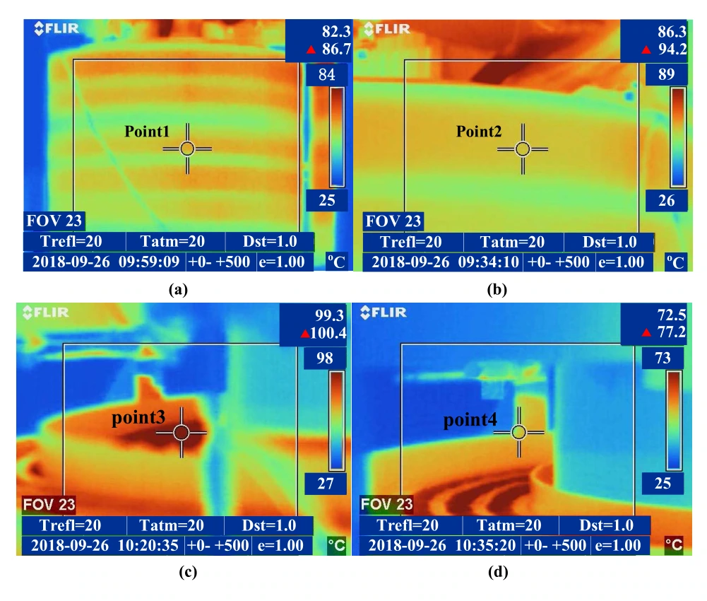

**Authors**　Yongjian Li, Xinxiao Yan, Chunguang Wang, Qingxin Yang, Changgeng Zhang 
**Journal**　IEEE Transactions on Magnetics 55(7), 8401705 (2019) 
**First published online**　4 March 2019 
**Journal issue**　July 2019, volume 55, issue 7 
**DOI**　`10.1109/TMAG.2019.2897503`

<a href="/assets/papers/2019/eddy-current-loss-in-transformer-foil-windings.pdf" download="eddy-current-loss-in-transformer-foil-windings.pdf">Download full paper (PDF)</a> · 5 pages · 1.6 MB

## Research brief

An insulation barrier changes both the flow of cooling air and radiative heat exchange between transformer windings. The team compared modeled temperatures with infrared measurements on a 2,500 kVA dry-type transformer to locate hot spots in and around its foil winding.

## Abstract

The foil winding temperature distribution is crucial to the life of power transformer since local heating can accelerate aging of insulation materials. However, based on the traditional 3-D electromagnetic model and the principle of heat transfer, the non-uniform losses and temperature distribution of foil windings are difficult to estimate because of complex magnetic leakage flux. In this paper, the magneto-fluid-thermal coupling model has been established to calculate the temperature rise and predict the potential hotspots of a simplified dry-type power transformer rated at 2500 kVA. Moreover, the influence of insulation barrier is considered to reshape the air-flow path and to affect the radiative effect between the high-voltage and low-voltage windings. Experimental temperature rises are measured with infrared thermography to verify the simulation results, which achieved reasonable hotspot predictions and provide the theoretical method for transformer designers.

<figure style="margin:1.5rem 0">
  
  <figcaption>Figure 9. Infrared measurements of the winding and insulation-barrier temperatures. <a href="/assets/papers/2019/eddy-current-loss-in-transformer-foil-windings.pdf#page=4">Figure in the full paper</a></figcaption>
</figure>

[Chinese edition](/zh/news/eddy-current-loss-in-transformer-foil-windings/) · [News of My Group](/categories)
