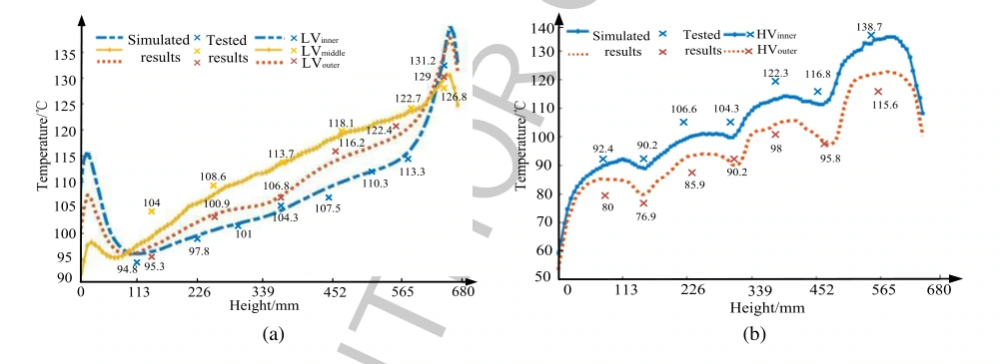

**作者**　闫鑫笑、李永建、程志光、张长庚 
**期刊**　《国际应用电磁学与力学杂志》，第 62 卷第 4 期，第 725–735 页 
**首次在线发表**　2020 年 4 月 1 日 
**DOI**　`10.3233/JAE-190054`

<a href="/assets/papers/2020/temperature-rise-in-a-ventilated-dry-type-transformer.pdf" download="temperature-rise-in-a-ventilated-dry-type-transformer.pdf">下载论文全文（PDF）</a> · 11 页 · 1.7 MB

## 研究简介

通风式干式变压器中，同一绕组沿高度方向的温度会随风道和发热位置而变。团队将箔式绕组涡流、铁芯各向异性损耗和风道内气流纳入同一模型。在 2,500 kVA 样机上，高、低压绕组所测位置的温升预测误差均在 7% 以内。

## 摘要

针对一台额定容量为 2,500 kVA 的通风式干式变压器，建立三维磁–流–热耦合模型，用于预测温升。为准确估算电磁损耗，提出考虑箔式绕组涡流损耗的三维瞬态有限元方法。采用两个正交方向的磁通密度–损耗曲线表征取向硅钢的各向异性，并将绕组与铁芯内不均匀分布的功率损耗映射到温度场，作为热源。模型还计及狭窄撑条、绝缘屏障和夹件等结构，以提高气流速度和温度分布的计算精度。最后通过温升试验验证了所提出的模型。

**关键词**　干式变压器、涡流、功率损耗、磁特性测量

<figure style="margin:1.5rem 0">
  
  <figcaption>图 10　低压与高压绕组沿轴向的温度计算值与实测值。 <a href="/assets/papers/2020/temperature-rise-in-a-ventilated-dry-type-transformer.pdf#page=9">图片所在页</a></figcaption>
</figure>

[英文版](/2020/04/01/temperature-rise-in-a-ventilated-dry-type-transformer) · [返回团队新闻](/team-news/)
