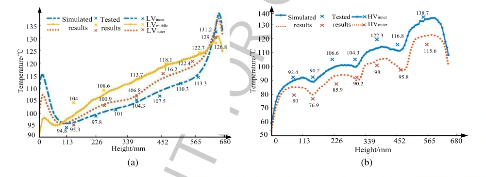

**Authors**　Xinxiao Yan, Yongjian Li, Zhiguang Cheng, Changgeng Zhang 
**Journal**　International Journal of Applied Electromagnetics and Mechanics 62(4), 725–735 (2020) 
**First published online**　1 April 2020 
**DOI**　`10.3233/JAE-190054`

<a href="/assets/papers/2020/temperature-rise-in-a-ventilated-dry-type-transformer.pdf" download="temperature-rise-in-a-ventilated-dry-type-transformer.pdf">Download full paper (PDF)</a> · 11 pages · 1.7 MB

## Research brief

Cooling air follows different paths along the height of a ventilated transformer. The team modeled the foil-winding eddy currents, directional core losses and airflow around the winding supports. On a 2,500 kVA unit, predicted temperature rises were within 7% of the measurements at the sampled winding positions.

## Abstract

A 3-D coupled magneto-fluid-thermal model is established for temperature rise prediction in a ventilated dry-type transformer rated at 2500 kVA. In order to accurately estimate electromagnetic losses, a three-dimensional (3-D) transient finite element method considering the effect of eddy-current losses on the foil type windings is proposed. Besides, two orthogonal B-P loss curves are adopted to model the anisotropy of grain-oriented (GO) silicon steel. The non-uniform power losses of winding and core are mapped into the thermal field as heat sources. Moreover, the transformer structures such as the narrow struts, insulation barrier and clamps are considered to improve the computational accuracy of air velocity and temperature distribution. At last, the test of temperature rise has been carried out to verify the proposed model.

**Keywords**　Dry-type transformer, eddy currents, power losses, magnetic measurements

<figure style="margin:1.5rem 0">
  
  <figcaption>Figure 10. Calculated and measured temperatures along the low-voltage and high-voltage windings. <a href="/assets/papers/2020/temperature-rise-in-a-ventilated-dry-type-transformer.pdf#page=9">Figure in the full paper</a></figcaption>
</figure>

[Chinese edition](/zh/news/temperature-rise-in-a-ventilated-dry-type-transformer/) · [News of My Group](/categories)
