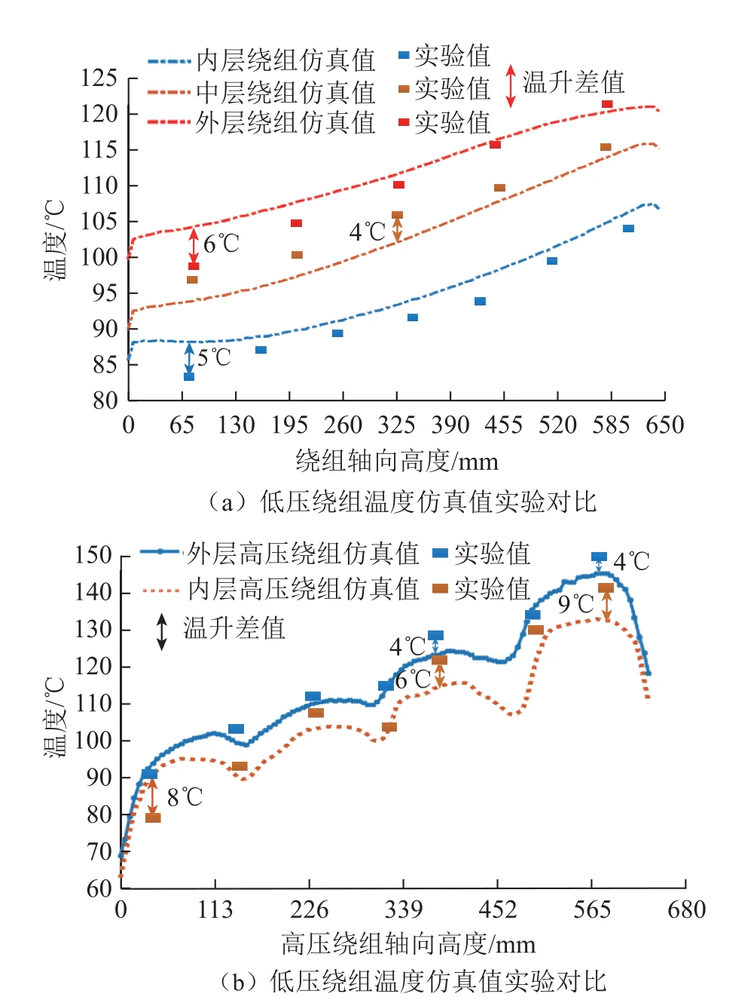

**作者**　李永建、闫鑫笑、张长庚、陈怡帆、盈文亮 
**期刊**　《电工技术学报》，第 35 卷第 21 期，第 4483–4491 页 
**刊出日期**　2020 年 11 月 10 日 
**DOI**　`10.19595/j.cnki.1000-6753.tces.191227`

<a href="/assets/papers/2020/losses-and-local-overheating-in-transformer-windings.pdf" download="losses-and-local-overheating-in-transformer-windings.pdf">下载论文全文（PDF）</a> · 9 页 · 4.8 MB

## 研究简介

漏磁通使箔式绕组各处发热不均，平均损耗难以揭示热点。团队在一台 2,500 kVA 干式变压器上，把每个网格单元的电磁损耗分别传入温度场，并计入温度对损耗的反作用。额定负载下，模型预测与温升试验的误差在 ±6% 以内。

## 摘要

基于有限元法对一台 2,500 kVA 干式变压器进行额定负载条件下的三维瞬态电磁场模拟仿真，计算中考虑了漏磁场对箔式绕组和结构件涡流分布的影响。将电磁损耗计算结果按照网格逐单元耦合至温度场，并以此为热源建立磁-热-流多物理场映射关系，考虑温度对材料损耗特性的影响，精确模拟变压器对流换热过程并实现变压器结构件温升计算和绕组热点预测。开展变压器温升试验，结果表明模型预测值与试验值误差控制在±6%，温升分布规律与实际吻合得较好。该文采用的多物理场双向耦合分析方法克服了传统磁路法损耗计算不准确的问题，在变压器产品研发初期可提供损耗预测方法和计算数据，显著提高相关电工装备的运行效率。

**关键词**　箔式绕组、涡流损耗、磁-热-流耦合、温升计算

<figure style="margin:1.5rem 0">
  
  <figcaption>图 15　高、低压绕组不同轴向位置的温度仿真值与试验值。 <a href="/assets/papers/2020/losses-and-local-overheating-in-transformer-windings.pdf#page=7">图片所在页</a></figcaption>
</figure>

[英文版](/2020/11/10/losses-and-local-overheating-in-transformer-windings) · [返回团队新闻](/team-news/)
