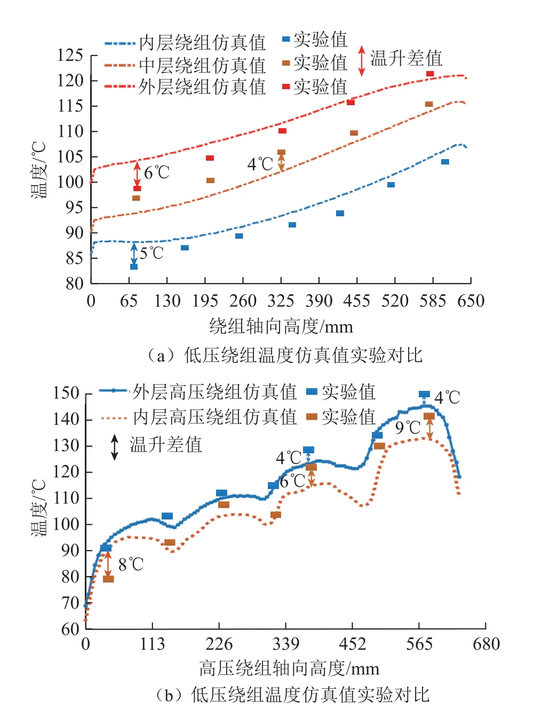

**Authors**　Yongjian Li, Xinxiao Yan, Changgeng Zhang, Yifan Chen, Wenliang Ying 
**Journal**　Transactions of China Electrotechnical Society 35(21), 4483–4491 (2020) 
**Issue publication date**　10 November 2020 
**DOI**　`10.19595/j.cnki.1000-6753.tces.191227`

<a href="/assets/papers/2020/losses-and-local-overheating-in-transformer-windings.pdf" download="losses-and-local-overheating-in-transformer-windings.pdf">Download full paper (PDF)</a> · 9 pages · 4.8 MB

## Research brief

Leakage flux heats some parts of a foil winding more than others. For a 2,500 kVA dry-type transformer, the team mapped the electrical loss in each mesh element into the thermal model and accounted for the effect of temperature on losses. Under rated load, the predicted values agreed with the temperature-rise test to within ±6%.

## Abstract

Based on finite element method, the 3-D transient electromagnetic field simulation of a 2500 kVA dry-type transformer under rated load condition is carried out. The effect of the leakage flux on the eddy current distribution in foil windings and structures is considered in the calculation. The magneto-thermal-fluid coupling model was established and the loss density on each mesh element was mapped into the 3-D thermal field as heat sources. Considering the influence of temperature on material loss characteristics, the convective heat transfer process is accurately simulated, and the calculation of transformer temperature rise and the prediction of winding hot spots are realized. The test of transformer temperature rise indicated that the error between the predicted value of the model and test results was controlled within ±6%. The temperature rise distribution law was in good agreement with actual situation. The multi-physics two-way coupling analysis method adopted in this paper overcomes the inaccurate of loss calculation by the traditional magnetic circuit method. It can provide loss prediction methods and calculation data at the initial stage of transformer product development, and significantly improve the operating efficiency of related electrical equipment.

**Keywords**　Foil-type windings, eddy-current losses, magnetic–thermal–fluid coupling, temperature rise

<figure style="margin:1.5rem 0">
  
  <figcaption>Figure 15. Simulated and measured temperatures at different axial positions in the high- and low-voltage windings. <a href="/assets/papers/2020/losses-and-local-overheating-in-transformer-windings.pdf#page=7">Figure in the full paper</a></figcaption>
</figure>

[Chinese edition](/zh/news/losses-and-local-overheating-in-transformer-windings/) · [News of My Group](/categories)
