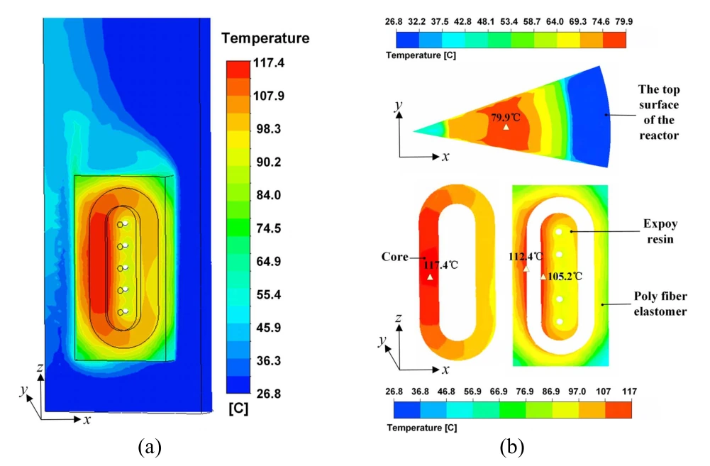

**作者**　陈怡帆、杨庆新、张长庚、李永建、王家俊 
**期刊**　《IEEE 磁学汇刊》，第 58 卷第 2 期，文章编号 6300705 
**首次在线发表**　2021 年 5 月 25 日 
**刊期**　2022 年 2 月，第 58 卷第 2 期 
**DOI**　`10.1109/TMAG.2021.3083649`

<a href="/assets/papers/2022/magnetic-thermal-coupling-in-a-saturable-reactor.pdf" download="magnetic-thermal-coupling-in-a-saturable-reactor.pdf">下载论文全文（PDF）</a> · 5 页 · 3.4 MB

## 研究简介

换流阀电抗器的最高温度可能出现在难以直接测量的铁芯内部。团队将不均匀铁损映射到流体与温度场模型，算得铁芯内部热点为 117.4 °C，电抗器内环面热点为 80.5 °C，并用温度实验检验了模型。

## 摘要

阳极饱和电抗器是特高压直流输电的重要设备，对换流阀的安全运行至关重要。本文以动态铁损模型为基础，利用有限元软件 Maxwell 分析电抗器的涡流并计算铁芯损耗。通过异构网格间的快速映射插值方法和 Fluent 用户自定义函数，将铁损从电磁场网格映射到流场网格，使热源分布更接近实际。随后采用计算流体力学软件 Fluent 求得电抗器的温度分布与流速分布。温度仿真表明，铁芯内部与电抗器内环面的热点温度分别为 117.4 °C 和 80.5 °C。实验结果验证了铁损与温度分布计算方法的有效性。

**关键词**　阳极饱和电抗器、动态铁损模型、异构网格映射、温度分布

<figure style="margin:1.5rem 0">
  
  <figcaption>图 9　阳极饱和电抗器的整体温度分布与局部温度分布。 <a href="/assets/papers/2022/magnetic-thermal-coupling-in-a-saturable-reactor.pdf#page=4">图片所在页</a></figcaption>
</figure>

[英文版](/2021/05/25/magnetic-thermal-coupling-in-a-saturable-reactor) · [返回团队新闻](/team-news/)
