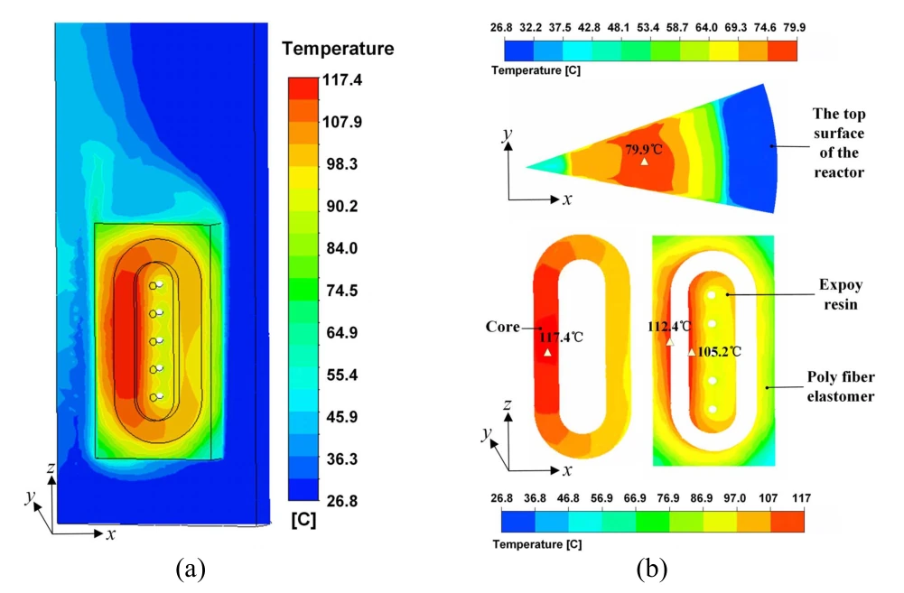

**Authors**　Yifan Chen, Qingxin Yang, Changgeng Zhang, Yongjian Li, Jiajun Wang 
**Journal**　IEEE Transactions on Magnetics 58(2), 6300705 (2022) 
**First published online**　25 May 2021 
**Journal issue**　February 2022, volume 58, issue 2 
**DOI**　`10.1109/TMAG.2021.3083649`

<a href="/assets/papers/2022/magnetic-thermal-coupling-in-a-saturable-reactor.pdf" download="magnetic-thermal-coupling-in-a-saturable-reactor.pdf">Download full paper (PDF)</a> · 5 pages · 3.4 MB

## Research brief

The hottest part of a converter-valve reactor can be hidden inside its core. Mapping the spatial distribution of core loss into a fluid and thermal model gave a simulated hot spot of 117.4 °C inside the core and 80.5 °C on the inner toroidal surface. Temperature measurements provided an experimental check.

## Abstract

As the vital equipment of ultra-high voltage direct current (UHVDC) transmission, the anodic saturable reactor is crucial to the safe operation of converter valve. Based on dynamic core loss model, the eddy current analysis and core loss calculation on saturable reactor are carried out by finite-element method (FEM) simulation software Maxwell. Through the fast-mapping interpolation method between heterogeneous meshes, the core loss is mapped from electromagnetic field to the fluid field by Fluent user-defined functions (UDFs), which makes the distribution of heat source more realistic. The distributions of temperature and velocity of the anodic saturable reactor are obtained by computational fluid dynamics (CFD) simulation software Fluent. The temperature simulation results show that the hottest spots inside the core and on the reactor inner toroidal surface are 117.4 °C and 80.5 °C, respectively. The experimental results demonstrate the validity of the calculation methods of core loss and temperature distribution.

**Keywords**　Anodic saturable reactor, dynamic core loss model, heterogeneous mesh mapping, temperature distribution

<figure style="margin:1.5rem 0">
  
  <figcaption>Figure 9. Overall and local temperature distributions of the anodic saturable reactor. <a href="/assets/papers/2022/magnetic-thermal-coupling-in-a-saturable-reactor.pdf#page=4">Figure in the full paper</a></figcaption>
</figure>

[Chinese edition](/zh/news/magnetic-thermal-coupling-in-a-saturable-reactor/) · [News of My Group](/categories)
