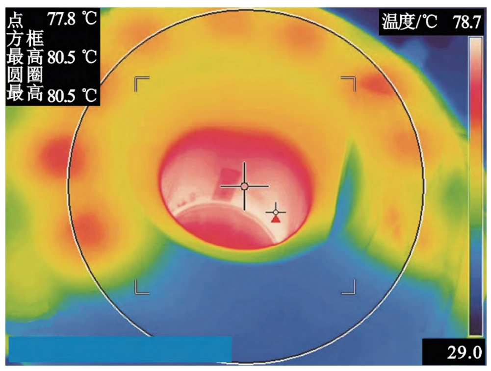

**作者**　张长庚、王家俊、李永建、杨庆新 
**期刊**　《高电压技术》，第 47 卷第 6 期，第 2158–2168 页 
**刊出日期**　2021 年 6 月 30 日 
**DOI**　`10.13336/j.1003-6520.hve.20201067`

<a href="/assets/papers/2021/dynamic-core-loss-in-converter-valve-saturable-reactors.pdf" download="dynamic-core-loss-in-converter-valve-saturable-reactors.pdf">下载论文全文（PDF）</a> · 11 页 · 2.1 MB

## 研究简介

换流阀开关过程中的脉冲电流会使电抗器铁芯损耗高于正弦激励。团队测量了超薄硅钢片的磁特性，计算气隙附近的涡流分布，并用电抗器温升试验验证损耗计算。实际工况下，外壳平均温度达到 76 ℃。

## 摘要

阳极饱和电抗器作为特高压直流输电关键装备，其铁芯损耗直接影响换流阀的安全运行。以动态铁芯损耗模型为基础，基于有限元法开展电抗器铁芯损耗计算和涡流分析。应用复合 B-H 传感技术搭建二维磁特性测量装置，测量超薄硅钢片在高磁通密度下的磁化曲线、比总损耗曲线等磁特性参数。基于电磁有限元仿真，建立阳极饱和电抗器铁芯均质化模型，计算实际工况下的损耗功率，分析磁场、损耗、涡流等分布规律。结果表明：换流阀开通和关断的过程中，阳极饱和电抗器在脉冲电流激励下的铁芯损耗远高于正弦激励损耗。由于漏磁场的影响，铁芯的气隙两侧存在较大涡流，沿铁芯带材边缘形成环流，漏磁场损耗主要分布在铁芯表面。通过阳极饱和电抗器温升试验测得其外壳平均温度在实际工况下可达 76 ℃，并由此验证了铁芯损耗计算的正确性。

**关键词**　阳极饱和电抗器、铁芯损耗、超薄硅钢片、有限元法、均质化模型

<figure style="margin:1.5rem 0">
  
  <figcaption>图 17　温升试验中饱和电抗器的红外热像。 <a href="/assets/papers/2021/dynamic-core-loss-in-converter-valve-saturable-reactors.pdf#page=9">图片所在页</a></figcaption>
</figure>

[英文版](/2021/06/30/dynamic-core-loss-in-converter-valve-saturable-reactors) · [返回团队新闻](/team-news/)
