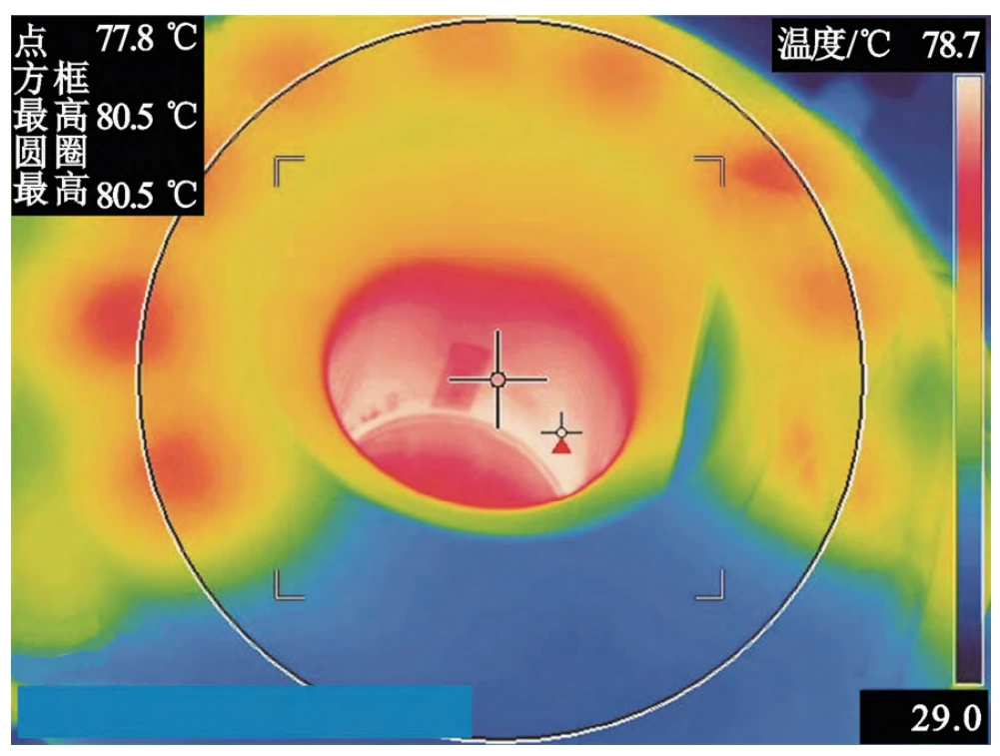

**Authors**　Changgeng Zhang, Jiajun Wang, Yongjian Li, Qingxin Yang 
**Journal**　High Voltage Engineering 47(6), 2158–2168 (2021) 
**Issue publication date**　30 June 2021 
**DOI**　`10.13336/j.1003-6520.hve.20201067`

<a href="/assets/papers/2021/dynamic-core-loss-in-converter-valve-saturable-reactors.pdf" download="dynamic-core-loss-in-converter-valve-saturable-reactors.pdf">Download full paper (PDF)</a> · 11 pages · 2.1 MB

## Research brief

When a converter valve switches, the current pulses drive more loss in the reactor core than a sinusoidal excitation. The researchers measured the properties of ultra-thin silicon steel, modeled the eddy currents near the core gap and checked their loss calculation against a reactor temperature-rise test. The mean housing temperature reached 76 °C.

## Abstract

The anode saturable reactor is a key device for UHVDC transmission, whose core loss directly affects the safety of converter valve. In this paper, based on the dynamic core loss model, the core loss calculation and eddy current analysis were carried out by the finite element method. A 2-D magnetic measurement device was built by composite B-H sensing technology. The magnetic characteristic parameters such as magnetization curves and specific total loss curves of the ultra-thin silicon steel sheets were measured. Based on the electromagnetic finite element simulation software, a homogenization model of the core of the anode saturable reactor was established. The power loss under actual working conditions was calculated, and the distributions of magnetic flux density, loss, and eddy current were analyzed. The results show that, in the process of switching on and off, the core loss of the anode saturable reactor under pulse current excitation distributes in the outermost layer of cores, which is much higher than the sinusoidal excitation loss. Due to the influence of the air gap on the leakage magnetic flux, the eddy currents flow along the edge of cores. The temperature rise experiment shows that the average temperature of the shell is measured up to 76 °C. Thereby, the correctness of the core loss calculation can be verified.

**Keywords**　Anode saturable reactor, core loss, ultra-thin silicon steel, finite element method, homogenization model

<figure style="margin:1.5rem 0">
  
  <figcaption>Figure 17. Infrared image of the saturable reactor during the temperature-rise test. <a href="/assets/papers/2021/dynamic-core-loss-in-converter-valve-saturable-reactors.pdf#page=9">Figure in the full paper</a></figcaption>
</figure>

[Chinese edition](/zh/news/dynamic-core-loss-in-converter-valve-saturable-reactors/) · [News of My Group](/categories)
