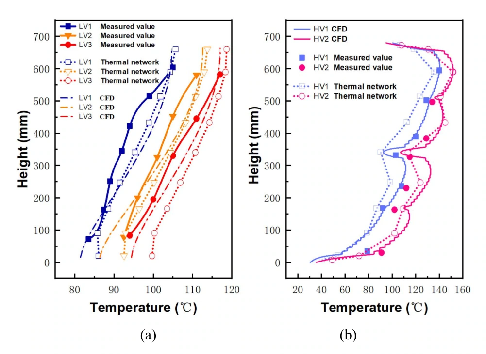

**作者**　陈怡帆、杨庆新、张长庚、李永建、李星汉 
**期刊**　《IEEE 磁学汇刊》，第 58 卷第 11 期，文章编号 8402105 
**首次在线发表**　2021 年 8 月 11 日 
**刊期**　2022 年 11 月，第 58 卷第 11 期 
**DOI**　`10.1109/TMAG.2021.3104090`

<a href="/assets/papers/2022/thermal-network-model-for-a-high-power-dry-type-transformer.pdf" download="thermal-network-model-for-a-high-power-dry-type-transformer.pdf">下载论文全文（PDF）</a> · 5 页 · 4.0 MB

## 研究简介

团队把一台 2,500 kVA 干式变压器的绕组划分为 11 个区域，将各处不同的电磁损耗和风道散热条件引入热网络。结合温升试验，研究确定热点位于最外层高压绕组顶部，温度为 151.8 °C。

## 摘要

本文基于热电类比方法提出一种与电磁损耗耦合的热网络模型，按照干式变压器绕组的实际结构建立精细热网络。考虑变压器内部热源沿冷却风道的分布特征，利用有限元分析和计算流体力学计算热流密度、对流换热系数等热参数。温升实验表明，热点位于最外层高压绕组顶部，温度为 151.8 °C，验证了热网络模型的正确性。

**关键词**　计算流体力学、对流换热系数、干式变压器、有限元法、热网络法

<figure style="margin:1.5rem 0">
  
  <figcaption>图 11　三种方法得到的低压绕组与高压绕组温度分布对比。 <a href="/assets/papers/2022/thermal-network-model-for-a-high-power-dry-type-transformer.pdf#page=5">图片所在页</a></figcaption>
</figure>

[英文版](/2021/08/11/thermal-network-model-for-a-high-power-dry-type-transformer) · [返回团队新闻](/team-news/)
