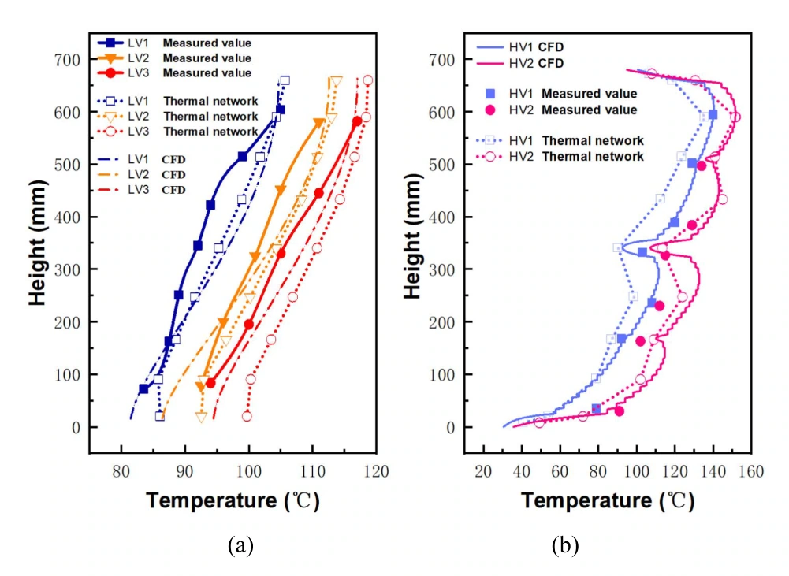

**Authors**　Yifan Chen, Qingxin Yang, Changgeng Zhang, Yongjian Li, Xinghan Li 
**Journal**　IEEE Transactions on Magnetics 58(11), 8402105 (2022) 
**First published online**　11 August 2021 
**Journal issue**　November 2022, volume 58, issue 11 
**DOI**　`10.1109/TMAG.2021.3104090`

<a href="/assets/papers/2022/thermal-network-model-for-a-high-power-dry-type-transformer.pdf" download="thermal-network-model-for-a-high-power-dry-type-transformer.pdf">Download full paper (PDF)</a> · 5 pages · 4.0 MB

## Research brief

A thermal network divided the windings of a 2,500 kVA dry-type transformer into 11 regions and accounted for differences in electromagnetic loss and cooling along the ducts. The temperature-rise study located the hot spot at the top of the outermost high-voltage winding, at 151.8 °C.

## Abstract

Based on thermoelectric analogy method, a thermal network model coupled with electromagnetic loss is presented. According to the actual structure of dry-type transformer windings, an accurate thermal network is established. Considering the distribution characteristics of heat source along the cooling ducts inside the dry-type transformer, the thermal parameters such as heat flux and convective heat transfer coefficients are calculated by finite element method (FEM) analysis and computational fluid dynamics (CFD). Based on the temperature rise experiment, the hottest spot located at the top of the outmost high-voltage (HV) winding is 151.8 °C, which verified the correctness of thermal network model.

**Keywords**　Computational fluid dynamics, convective heat transfer coefficient, dry-type transformer, finite element method, thermal network method

<figure style="margin:1.5rem 0">
  
  <figcaption>Figure 11. Comparison of low- and high-voltage winding temperatures obtained by three methods. <a href="/assets/papers/2022/thermal-network-model-for-a-high-power-dry-type-transformer.pdf#page=5">Figure in the full paper</a></figcaption>
</figure>

[Chinese edition](/zh/news/thermal-network-model-for-a-high-power-dry-type-transformer/) · [News of My Group](/categories)
