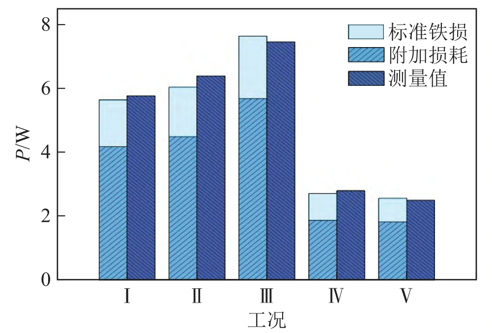

**作者**　张长庚、田亚坤、李永建、利雅婷、杜振斌、程志光、杨庆新 
**期刊**　《电工技术学报》，第 37 卷第 15 期，第 3733–3742 页 
**刊出日期**　2022 年 8 月 10 日 
**DOI**　`10.19595/j.cnki.1000-6753.tces.210804`

<a href="/assets/papers/2022/stray-loss-in-laminated-transformer-shields-under-harmonics-and-dc-bias.pdf" download="stray-loss-in-laminated-transformer-shields-under-harmonics-and-dc-bias.pdf">下载论文全文（PDF）</a> · 10 页 · 1.8 MB

## 研究简介

团队在改进的 TEAM P21 基准模型上实测磁屏蔽叠片损耗。对文中工况Ⅲ和Ⅳ，采用实际非正弦激励下的磁性能数据后，损耗计算相对误差分别由 6.17% 和 7.00% 降至 2.36% 和 2.93%。

## 摘要

为研究电力变压器叠片式磁屏蔽在谐波和直流偏磁条件下的杂散损耗，对 TEAM P21 基准族（V.2009）进行拓展改进，增加激励线圈匝数，增大导线截面积和磁屏蔽叠片的尺寸。搭建变压器杂散损耗测量平台，提出并实现了谐波及直流偏磁下杂散损耗的测量方法。测量得到取向硅钢片在谐波和直流偏磁下的磁性能数据，完成了复杂激励条件下杂散场和损耗的多工况三维瞬态有限元计算。通过杂散场和损耗的仿真与实验结果的对比，验证了测量方法及仿真计算的有效性。结合仿真及实验结果，分析了谐波和直流偏磁下杂散损耗的分布及其影响，所得结果及结论有助于变压器磁屏蔽的优化设计和提高电磁设备的可靠性。

**关键词**　TEAM P21 基准族、磁屏蔽、杂散损耗、谐波激励、直流偏磁

<figure style="margin:1.5rem 0">
  
  <figcaption>图 14　五种激励工况下硅钢叠片损耗的计算值与实测值。 <a href="/assets/papers/2022/stray-loss-in-laminated-transformer-shields-under-harmonics-and-dc-bias.pdf#page=7">图片所在页</a></figcaption>
</figure>

[英文版](/2022/08/10/stray-loss-in-laminated-transformer-shields-under-harmonics-and-dc-bias) · [返回团队新闻](/team-news/)
