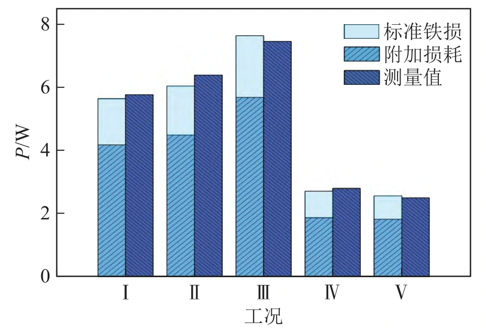

**Authors**　Changgeng Zhang, Yakun Tian, Yongjian Li, Yating Li, Zhenbin Du, Zhiguang Cheng, Qingxin Yang 
**Journal**　Transactions of China Electrotechnical Society 37(15), 3733–3742 (2022) 
**Issue publication date**　10 August 2022 
**DOI**　`10.19595/j.cnki.1000-6753.tces.210804`

<a href="/assets/papers/2022/stray-loss-in-laminated-transformer-shields-under-harmonics-and-dc-bias.pdf" download="stray-loss-in-laminated-transformer-shields-under-harmonics-and-dc-bias.pdf">Download full paper (PDF)</a> · 10 pages · 1.8 MB

## Research brief

A modified TEAM P21 benchmark provided a common test for measured and calculated losses in a laminated transformer shield. For cases III and IV, using magnetic properties measured under the actual nonsinusoidal excitation reduced the loss errors from 6.17% and 7.00% to 2.36% and 2.93%, respectively.

## Abstract

In order to study the stray-field loss in laminated magnetic shield of transformer under harmonics and DC bias, an improved model was proposed based on TEAM P21(Testing Electromagnetic Analysis Methods Problem 21) family (V.2009). The turn number, the cross section of exciting coil, and the size of magnetic shield sheets were increased. A measuring system of stray-field loss in laminated magnetic shield of transformer was designed. The corresponding measuring method of stray-field loss under harmonics and DC bias was proposed. Magnetic properties of GO silicon steel sheet were measured under complex excitations of harmonics and DC bias, which are essential to numerical modeling and simulation correctly. The calculated and measured stray flux density and stray-field loss in laminated magnetic shield were practically in good agreement, which verified the effectiveness of the numerical simulation. The distribution of stray-field loss was discussed and the results would be beneficial to the design of magnetic shield of transformer and improve the reliability of electromagnetic apparatus.

**Keywords**　TEAM P21 family, magnetic shield, stray-field loss, harmonics excitation, DC bias

<figure style="margin:1.5rem 0">
  
  <figcaption>Figure 14. Measured and calculated loss in the silicon-steel laminations for five excitation cases. <a href="/assets/papers/2022/stray-loss-in-laminated-transformer-shields-under-harmonics-and-dc-bias.pdf#page=7">Figure in the full paper</a></figcaption>
</figure>

[Chinese edition](/zh/news/stray-loss-in-laminated-transformer-shields-under-harmonics-and-dc-bias/) · [News of My Group](/categories)
