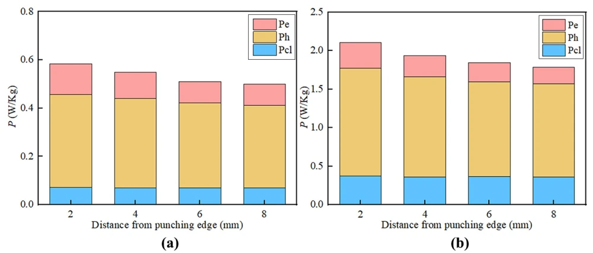

**作者**　张长庚、杨兰、李永建 
**期刊**　《COMPEL》，第 42 卷第 1 期，第 159–168 页 
**首次在线发表**　2022 年 9 月 5 日 
**刊期**　2023 年 1 月 12 日，第 42 卷第 1 期 
**DOI**　`10.1108/COMPEL-01-2022-0064`

<a href="/assets/papers/2023/local-magnetic-properties-near-punched-edges.pdf" download="local-magnetic-properties-near-punched-edges.pdf">下载论文全文（PDF）</a> · 10 页 · 1.7 MB

## 研究简介

冲压会改变切边附近多大范围的磁性能？团队用微型 B–H 传感器从边缘向内逐点测量。冲压应力为 80 MPa 和 250 MPa 的两组试样，磁性能劣化区分别延伸至约 6 mm 和 12 mm。局部损耗测量进一步区分了磁滞损耗和附加损耗的增量。

## 摘要

**研究目的**　考察冲压对无取向电工钢片局部磁特性的影响。

**研究方法**　设计微型复合 B–H 传感器，包含间距为 2 mm 的一对磁通密度探针，以及尺寸为 1.8 mm × 1.8 mm 的磁场强度测量线圈。通过移动传感器，可定量分析冲压造成的局部磁性能劣化范围和程度。基于 Bertotti 损耗分离理论，分析冲压对磁滞损耗、涡流损耗和附加损耗的影响及其物理机制。

**研究结果**　冲压使无取向电工钢边缘附近的磁导率下降，铁损与显微硬度增加。磁性能劣化的范围与加工硬化区域有关。

**研究价值**　微型复合 B–H 传感器可用于测量不同加工条件下电工钢片边缘附近的磁特性，为精细建立冲压后电机铁芯的磁特性模型提供手段，对铁芯未经退火的电机尤有价值。

**关键词**　电机、电磁场、功率损耗、磁性器件、电磁检测、冲压效应、局部磁特性、无取向电工钢、损耗分离

<figure style="margin:1.5rem 0">
  
  <figcaption>图 11　试样 1 在 0.8 T 和 1.4 T 下，距冲压边缘不同位置的磁滞损耗、涡流损耗和附加损耗。 <a href="/assets/papers/2023/local-magnetic-properties-near-punched-edges.pdf#page=9">图片所在页</a></figcaption>
</figure>

[英文版](/2022/09/05/local-magnetic-properties-near-punched-edges) · [返回团队新闻](/team-news/)
