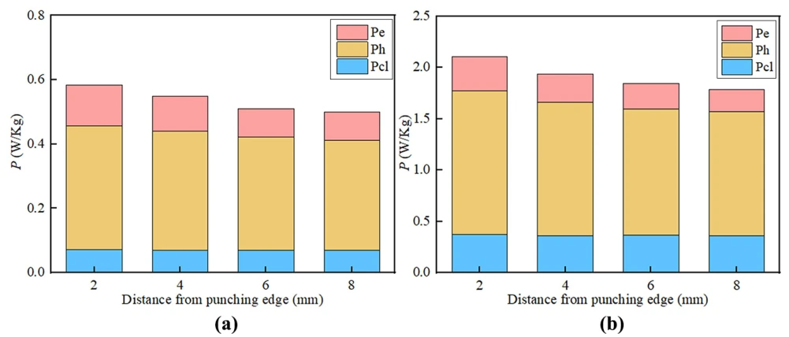

**Authors**　Changgeng Zhang, Lan Yang, Yongjian Li 
**Journal**　COMPEL – The International Journal for Computation and Mathematics in Electrical and Electronic Engineering 42(1), 159–168 (2023) 
**First published online**　5 September 2022 
**Journal issue**　12 January 2023, volume 42, issue 1 
**DOI**　`10.1108/COMPEL-01-2022-0064`

<a href="/assets/papers/2023/local-magnetic-properties-near-punched-edges.pdf" download="local-magnetic-properties-near-punched-edges.pdf">Download full paper (PDF)</a> · 10 pages · 1.7 MB

## Research brief

A miniature B–H sensor mapped magnetic damage inward from a punched edge. In sheets punched at 80 and 250 MPa, the affected regions extended about 6 and 12 mm from the edge, respectively. Local loss measurements showed how much of the increase came from hysteresis and excess loss.

## Abstract

**Purpose**　The purpose of this study is to investigate the effect of punching on the local magnetic properties of the nonoriented electrical steel sheet.

**Design/methodology/approach**　A microcomposite B–H sensor consisting of a pair of B probes with a spacing of 2 mm and a 1.8 × 1.8 mm² H coil is designed. The region and degree of local magnetic properties degradation caused by punching can be quantitatively analyzed by flexibly moving the composite B–H sensor. The influence and physical mechanism of punching on the hysteresis loss, eddy current loss and excess loss are analyzed based on the Bertotti loss separation theory.

**Findings**　This study investigates the deterioration effect of the punched nonoriented electrical steel. The permeability near the edge decreases, and the core loss as well as the microhardness increases. The region of magnetic property deterioration is dependent on the area of work hardening.

**Originality/value**　The microcomposite B–H sensor can be used to measure the magnetic properties near the edge of electrical steel sheets under different processing conditions. This study provides the possibility of precise magnetic property model of the motor core after punching, especially valuable for motors without annealing process.

**Keywords**　Electrical machine, electromagnetic fields, power losses, magnetic device, electromagnetic testing, punching effects, local magnetic properties, nonoriented electrical steels, loss separation

<figure style="margin:1.5rem 0">
  
  <figcaption>Figure 11. Hysteresis, eddy-current and excess loss at different distances from the punched edge of sample 1 at 0.8 and 1.4 T. <a href="/assets/papers/2023/local-magnetic-properties-near-punched-edges.pdf#page=9">Figure in the full paper</a></figcaption>
</figure>

[Chinese edition](/zh/news/local-magnetic-properties-near-punched-edges/) · [News of My Group](/categories)
