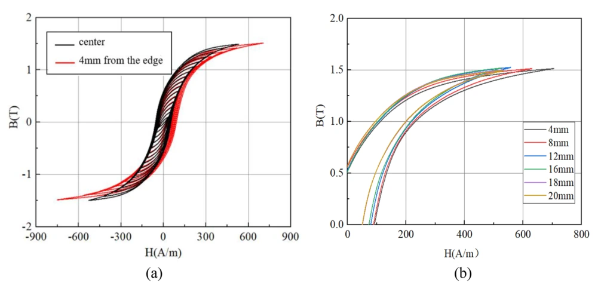

**作者**　张长庚、张妍、李永建、杨庆新 
**期刊**　AIP Advances，第 13 卷第 2 期，文章编号 025360 
**首次在线发表**　2023 年 2 月 24 日 
**DOI**　`10.1063/9.0000586`

<a href="/assets/papers/2023/laser-cutting-and-magnetic-degradation-of-non-oriented-steel.pdf" download="laser-cutting-and-magnetic-degradation-of-non-oriented-steel.pdf">下载论文全文（PDF）</a> · 7 页 · 7.9 MB

## 研究简介

激光切割对电机铁芯叠片的影响能深入到什么位置？团队沿 35WW250 无取向电工钢的切边逐点测量磁滞回线，发现磁性能劣化区向内延伸至 18 mm，并通过磁光成像观察了从边缘到内部的磁畴形貌变化。

## 摘要

电机制造中广泛采用激光切割来加工铁芯叠片。高能激光束引入的内应力会使无取向硅钢的磁性能劣化。为了准确预测电机铁芯损耗，需要分析激光切割造成的磁性能劣化程度及其机理。本文首先在正弦交变激励下测量 35WW250 无取向电工钢不同位置的局部磁特性，并从宏观层面以铁损评估劣化程度。随后从微观层面观察切边附近的磁畴形貌，研究磁畴在外加磁场下的演变。实验表明，激光切割使该试样的磁性能劣化区从切边沿横向延伸至 18 mm。不同位置的磁畴形貌也出现显著差异。磁光观测与局部磁测量共同验证了分析方法的有效性，为评估和改进硅钢加工工艺提供了依据。

<figure style="margin:1.5rem 0">
  
  <figcaption>图 2　试样中心与距切边 4 mm 处的磁滞回线对比，以及切边附近不同位置的局部磁滞回线。 <a href="/assets/papers/2023/laser-cutting-and-magnetic-degradation-of-non-oriented-steel.pdf#page=4">图片所在页</a></figcaption>
</figure>

[英文版](/2023/02/24/laser-cutting-and-magnetic-degradation-of-non-oriented-steel) · [返回团队新闻](/team-news/)
