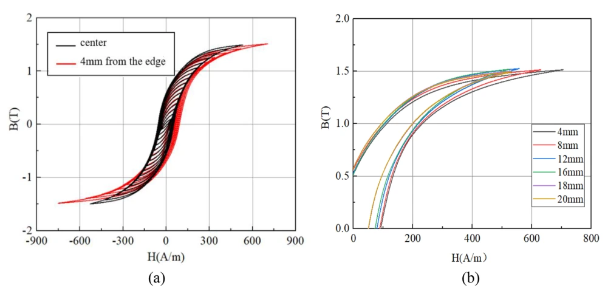

**Authors**　Changgeng Zhang, Yan Zhang, Yongjian Li, Qingxin Yang 
**Journal**　AIP Advances 13(2), 025360 (2023) 
**First published online**　24 February 2023 
**DOI**　`10.1063/9.0000586`

<a href="/assets/papers/2023/laser-cutting-and-magnetic-degradation-of-non-oriented-steel.pdf" download="laser-cutting-and-magnetic-degradation-of-non-oriented-steel.pdf">Download full paper (PDF)</a> · 7 pages · 7.9 MB

## Research brief

How far does the effect of a laser cut extend into a motor lamination? Local hysteresis measurements on 35WW250 electrical steel detected magnetic degradation as far as 18 mm from the cut edge. Magneto-optical images showed how the domain pattern changed across the same region.

## Abstract

In the manufacturing process of electrical machines, laser cutting is widely used to produce the laminations of cores. The internal stresses introduced by the high-energy laser beam will lead to deterioration in the magnetic properties of the non-oriented silicon steels. To accurately predict the core losses of the electrical machines, it is important to analyze the deterioration degree and the deterioration mechanism of the non-oriented steel sheets caused by laser cutting. In this paper, first, the local magnetic properties of the non-oriented steel 35WW250 at different positions are measured under the alternating sinusoidal excitation, in which the degradation degree is evaluated based on the core loss from the macroscopic perspective. Second, from the microscopic perspective, the observed magnetic domain patterns at the edge and those evolutions under the excitation of the magnetic field are investigated. The experimental results demonstrate that laser cutting can lead to the magnetic degradation of the non-oriented steels with a transverse depth of 18 mm from the edge. Moreover, the laser cutting process leads to significant variations in the patterns of the magnetic domains at different positions. The magneto-optical observation and local magnetic measurement verified the effectiveness of the analytical method, which is of great significance for the evaluation and improvement of the processing technique of the silicon steels.

<figure style="margin:1.5rem 0">
  
  <figcaption>Figure 2. Local hysteresis loops at the center of the sheet, 4 mm from the cut edge and at other distances from the edge. <a href="/assets/papers/2023/laser-cutting-and-magnetic-degradation-of-non-oriented-steel.pdf#page=4">Figure in the full paper</a></figcaption>
</figure>

[Chinese edition](/zh/news/laser-cutting-and-magnetic-degradation-of-non-oriented-steel/) · [News of My Group](/categories)
