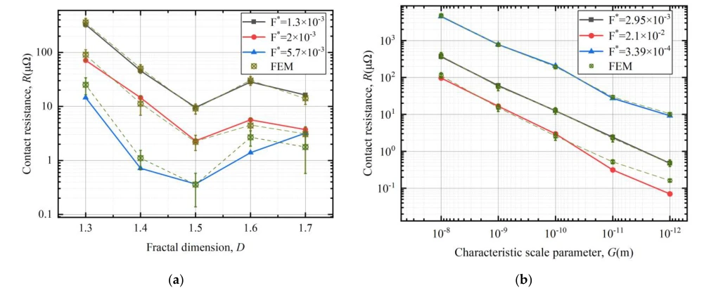

**作者**　张长庚、余百川、李永建、杨庆新 
**期刊**　《应用科学》，第 13 卷第 6 期，文章编号 3648 
**首次在线发表**　2023 年 3 月 13 日 
**DOI**　`10.3390/app13063648`

<a href="/assets/papers/2023/contact-resistance-of-fractal-rough-surfaces.pdf" download="contact-resistance-of-fractal-rough-surfaces.pdf">下载论文全文（PDF）</a> · 15 页 · 7.4 MB

<a href="/assets/papers/2023/contact-resistance-of-fractal-rough-surfaces-with-cover.pdf" download="contact-resistance-of-fractal-rough-surfaces-with-cover.pdf">下载带封面的全文（PDF）</a> · 16 页 · 2.2 MB

## 研究简介

两个导体表面贴合时，电流实际流经哪些微小接触区？团队用分形和蒙特卡洛方法重建粗糙表面，计算真实接触面积和表面污染膜对电阻的影响。在所比较的表面中，给定载荷下分形维数为 1.5 时接触电阻最小。

## 摘要

电接触电阻是评估电气连接稳定性与可靠性的重要指标。本文基于分形理论和蒙特卡洛方法建立粗糙表面的简化接触模型，解决传统接触模型中电阻网络难以构建的问题。模型揭示了分形参数 D 和 G 对表面形貌及接触特性的影响。所提出的表面生成方法能够模拟具有高斯和非高斯分布的各向同性表面。在此基础上，研究计算了计及表面污染膜的接触电阻，定量分析了电阻变化及其影响因素。通过与已有实验数据和有限元结果对比，验证了计算方法的准确性。结果表明，在所比较的条件下，分形维数 D 为 1.5 的表面具有最大的真实接触面积和最小的接触电阻。无量纲接触载荷 F* 小于 4 × 10⁻³ 时，模型具有较好的计算精度。

**关键词**　分形、粗糙表面、接触特性、接触电阻

<figure style="margin:1.5rem 0">
  
  <figcaption>图 15　改变分形维数或粗糙度特征参数时，模型计算的接触电阻与有限元结果的对比。 <a href="/assets/papers/2023/contact-resistance-of-fractal-rough-surfaces.pdf#page=13">图片所在页</a></figcaption>
</figure>

[英文版](/2023/03/13/contact-resistance-of-fractal-rough-surfaces) · [返回团队新闻](/team-news/)
