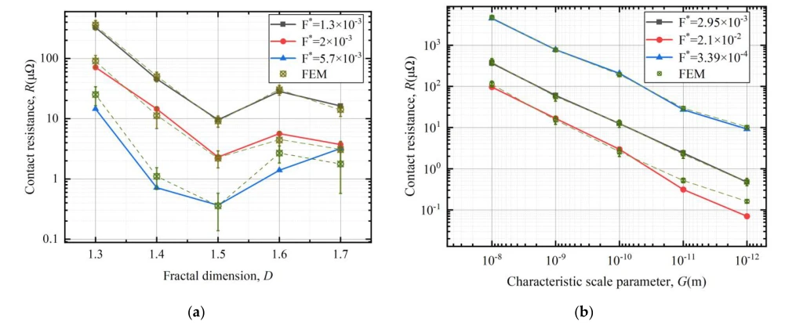

**Authors**　Changgeng Zhang, Baichuan Yu, Yongjian Li, Qingxin Yang 
**Journal**　Applied Sciences 13(6), 3648 (2023) 
**First published online**　13 March 2023 
**DOI**　`10.3390/app13063648`

<a href="/assets/papers/2023/contact-resistance-of-fractal-rough-surfaces.pdf" download="contact-resistance-of-fractal-rough-surfaces.pdf">Download full paper (PDF)</a> · 15 pages · 7.4 MB

<a href="/assets/papers/2023/contact-resistance-of-fractal-rough-surfaces-with-cover.pdf" download="contact-resistance-of-fractal-rough-surfaces-with-cover.pdf">Download full paper with cover (PDF)</a> · 16 pages · 2.2 MB

## Research brief

The apparent contact area of two conductors hides the small patches that actually carry current. A statistical model links those patches and a surface film to contact resistance. Among the surfaces studied at a given load, a fractal dimension of 1.5 gave the lowest resistance.

## Abstract

Electrical contact resistance (ECR) is critical to evaluate the stability and reliability of electrical connections. In this paper, a simplified contact model is established for rough surfaces based on the fractal theory and Monte Carlo method, which can overcome the difficulty of constructing the resistance networks for traditional contact models. The model reveals the influence of fractal parameters D and G on the surface morphology and contact characteristics. The established surface method can simulate Gaussian and non-Gaussian isotropic surfaces. Then the contact resistance considering a contaminated film is calculated, which provides a quantitative analysis of the change and the influencing factors. The accuracy of the calculation method in this paper is ensured by comparing the existing experimental data and finite element results. The results show that the contact surface with D of 1.5 has the largest real contact area and the smallest contact resistance. The model has accurate calculation results when dimensionless contact load F* is less than 4 × 10⁻³.

**Keywords**　Fractals, rough surfaces, contact characteristics, contact resistance

<figure style="margin:1.5rem 0">
  
  <figcaption>Figure 15. Calculated contact resistance compared with finite-element results as the fractal dimension or the roughness parameter varies. <a href="/assets/papers/2023/contact-resistance-of-fractal-rough-surfaces.pdf#page=13">Figure in the full paper</a></figcaption>
</figure>

[Chinese edition](/zh/news/contact-resistance-of-fractal-rough-surfaces/) · [News of My Group](/categories)
