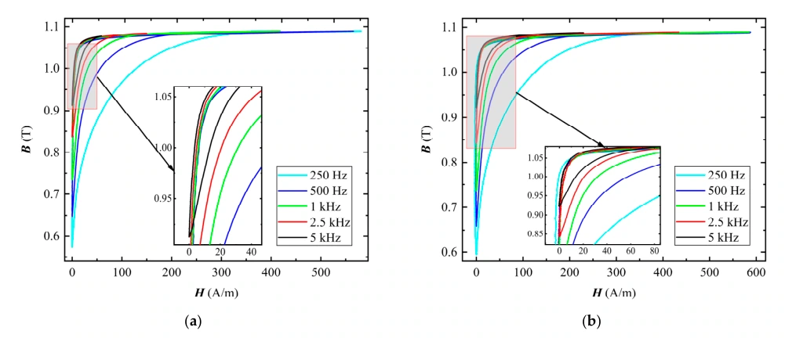

**作者**　张长庚、张民、李永建 
**期刊**　《材料》，第 16 卷第 7 期，文章编号 2850 
**首次在线发表**　2023 年 4 月 3 日 
**DOI**　`10.3390/ma16072850`

<a href="/assets/papers/2023/nanocrystalline-cores-under-pulsed-excitation.pdf" download="nanocrystalline-cores-under-pulsed-excitation.pdf">下载论文全文（PDF）</a> · 11 页 · 10.7 MB

## 研究简介

在脉冲电压幅值相同的条件下，提高重复频率或减小占空比都会使实测局部磁滞回线变窄。在 1 kHz 的场路耦合仿真中，占空比为 5% 时磁芯经过 5 个脉冲达到饱和，占空比降至 1% 时则需要 9 个脉冲。

## 摘要

为拓展纳米晶软磁材料在极端工况电气工程中的应用，纳米晶合金还需在高频和非正弦激励下保持良好的磁性能。本文测量了高重复频率脉冲激励下铁基纳米晶合金的磁特性。激励频率和占空比是研究脉冲磁特性的两个重要因素。保持脉冲幅值不变，通过改变频率和占空比获得不同的局部磁滞回线。实验结果表明，频率越高、占空比越小，局部磁滞回线越窄。最后，基于实测磁特性，采用有限元法建立磁芯与脉冲电路的耦合模型。仿真与实验结果的对比表明，场路耦合模型能够反映频率和占空比对磁特性的影响规律。

**关键词**　脉冲激励、纳米晶合金、磁特性、有限元法、场路耦合

<figure style="margin:1.5rem 0">
  
  <figcaption>图 4　占空比分别为 1% 和 5% 时，不同脉冲重复频率下实测的局部磁滞回线。 <a href="/assets/papers/2023/nanocrystalline-cores-under-pulsed-excitation.pdf#page=5">图片所在页</a></figcaption>
</figure>

[英文版](/2023/04/03/nanocrystalline-cores-under-pulsed-excitation) · [返回团队新闻](/team-news/)
