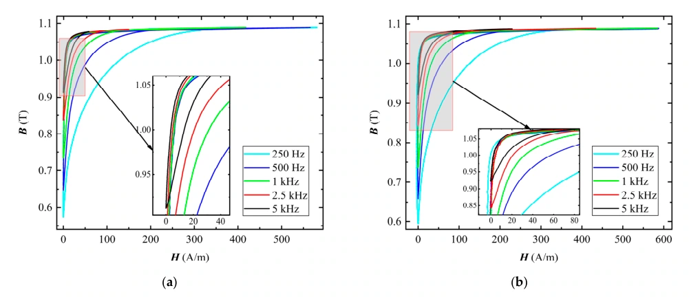

**Authors**　Changgeng Zhang, Min Zhang, Yongjian Li 
**Journal**　Materials 16(7), 2850 (2023) 
**First published online**　3 April 2023 
**DOI**　`10.3390/ma16072850`

<a href="/assets/papers/2023/nanocrystalline-cores-under-pulsed-excitation.pdf" download="nanocrystalline-cores-under-pulsed-excitation.pdf">Download full paper (PDF)</a> · 11 pages · 10.7 MB

## Research brief

With the pulse voltage held constant, increasing the repetition rate or reducing the duty cycle narrowed the measured minor hysteresis loops. At 1 kHz the field–circuit simulation showed the core reaching saturation after five pulses at 5% duty and nine pulses at 1% duty.

## Abstract

In order to broaden the application of nanocrystalline soft magnetic materials in electrical engineering under extreme conditions, nanocrystalline alloys must also have good characteristics under high-frequency and nonsinusoidal excitation. In this paper, the magnetic properties of Fe-based nanocrystalline alloys excited by high repetition frequency pulses were measured. Excitation frequency and duty cycles are two important factors in the study of magnetic properties under pulse excitation. With the amplitude of the pulse remaining constant, different local hysteresis curves were obtained by changing the frequency and duty cycle. The experimental results proved that the higher the frequency is and the smaller the duty cycle is, the narrower the local hysteresis loop is. Finally, the finite element method (FEM) was used to model the magnetic core coupling with an impulse circuit based on the measured magnetic properties. Compared with the experimental results, the simulation results showed that the field-circuit coupling analysis model can effectively reflect the influence law of the frequency and duty cycle on magnetic properties.

**Keywords**　Pulse excitation, nanocrystalline alloy, magnetic properties, finite element method, field–circuit coupling

<figure style="margin:1.5rem 0">
  
  <figcaption>Figure 4. Measured local hysteresis loops at several pulse repetition frequencies for duty cycles of 1% and 5%. <a href="/assets/papers/2023/nanocrystalline-cores-under-pulsed-excitation.pdf#page=5">Figure in the full paper</a></figcaption>
</figure>

[Chinese edition](/zh/news/nanocrystalline-cores-under-pulsed-excitation/) · [News of My Group](/categories)
