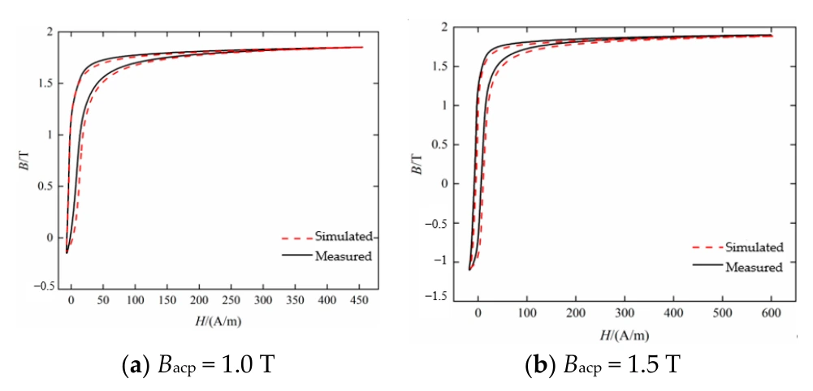

**作者**　张长庚、栗浩然、田亚坤、李永建、杨庆新 
**期刊**　《材料》，第 16 卷第 12 期，文章编号 4385 
**首次在线发表**　2023 年 6 月 14 日 
**DOI**　`10.3390/ma16124385`

<a href="/assets/papers/2023/harmonic-and-dc-bias-hysteresis-with-an-improved-preisach-model.pdf" download="harmonic-and-dc-bias-hysteresis-with-an-improved-preisach-model.pdf">下载论文全文（PDF）</a> · 14 页 · 5.9 MB

## 研究简介

取向硅钢的磁滞回线在直流偏磁下会出现不对称。团队从实测极限回线生成一阶反转曲线，建立不同偏磁场下的 Everett 函数，再用谐波和直流偏磁实验检验计算结果。

## 摘要

变压器、电抗器等电气设备经常在含谐波和直流偏磁的工况下运行。为了准确计算铁芯损耗并优化设备设计，需要快速、准确地模拟软磁材料在多种激励条件下的磁滞特性。本文基于 Preisach 磁滞模型设计了用于模拟不对称磁滞回线的参数辨识方法，并将其用于取向硅钢片偏磁工况的磁滞特性计算。通过实验获得不同工况下的极限磁滞回线，数值生成具有不对称特征的一阶反转曲线，进而建立不同直流偏磁条件下的 Everett 函数。通过改进 Preisach 模型的一阶反转曲线辨识方法，模拟了取向硅钢片在谐波和直流偏磁下的磁滞特性。仿真与实验结果的对比验证了该方法的有效性，可为材料生产与应用提供参考。

**关键词**　Preisach 模型、直流偏磁、损耗分离理论、取向硅钢片

<figure style="margin:1.5rem 0">
  
  <figcaption>图 11　直流偏磁场为 50 A/m、交流磁通密度峰值分别为 1.0 T 和 1.5 T 时，静态磁滞回线的实测与计算结果。 <a href="/assets/papers/2023/harmonic-and-dc-bias-hysteresis-with-an-improved-preisach-model.pdf#page=11">图片所在页</a></figcaption>
</figure>

[英文版](/2023/06/14/harmonic-and-dc-bias-hysteresis-with-an-improved-preisach-model) · [返回团队新闻](/team-news/)
