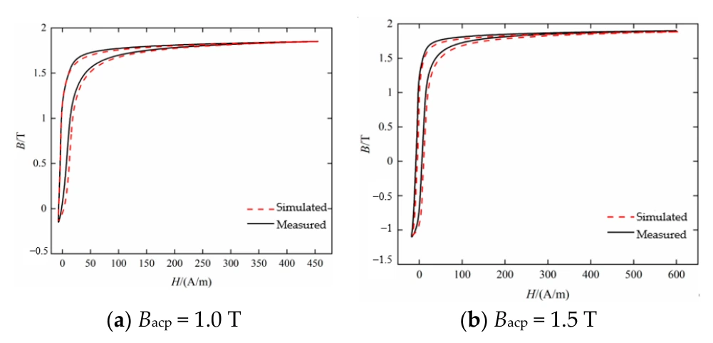

**Authors**　Changgeng Zhang, Haoran Li, Yakun Tian, Yongjian Li, Qingxin Yang 
**Journal**　Materials 16(12), 4385 (2023) 
**First published online**　14 June 2023 
**DOI**　`10.3390/ma16124385`

<a href="/assets/papers/2023/harmonic-and-dc-bias-hysteresis-with-an-improved-preisach-model.pdf" download="harmonic-and-dc-bias-hysteresis-with-an-improved-preisach-model.pdf">Download full paper (PDF)</a> · 14 pages · 5.9 MB

## Research brief

DC bias makes the hysteresis loop of grain-oriented steel asymmetric. The team used measured limiting loops to generate first-order reversal curves and construct Everett functions for different bias fields. Measurements under harmonic excitation and DC bias were used to test the model.

## Abstract

Transformers, reactors and other electrical equipment often work under harmonics and DC-bias working conditions. It is necessary to quickly and accurately simulate the hysteresis characteristics of soft magnetic materials under various excitation conditions in order to achieve accurate calculations of core loss and the optimal design of electrical equipment. Based on Preisach hysteresis model, a parameter identification method for asymmetric hysteresis loop simulation is designed and applied to the simulation of hysteresis characteristics under bias conditions of oriented silicon steel sheets. In this paper, the limiting hysteresis loops of oriented silicon steel sheets are obtained through experiments under different working conditions. The first-order reversal curves (FORCs) with asymmetric characteristics is generated numerically, and then the Everett function is established under different DC bias conditions. The hysteresis characteristics of the oriented silicon steel sheets under harmonics and DC bias are simulated by improving FORCs identification method of the Preisach model. By comparing the results of simulation and experiment, the effectiveness of the proposed method is verified, so as to provide an important reference for material production and application.

**Keywords**　Preisach model, DC bias, loss separation theory, grain-oriented silicon steel sheets

<figure style="margin:1.5rem 0">
  
  <figcaption>Figure 11. Measured and simulated static hysteresis loops at a DC field of 50 A/m for peak AC flux densities of 1.0 and 1.5 T. <a href="/assets/papers/2023/harmonic-and-dc-bias-hysteresis-with-an-improved-preisach-model.pdf#page=11">Figure in the full paper</a></figcaption>
</figure>

[Chinese edition](/zh/news/harmonic-and-dc-bias-hysteresis-with-an-improved-preisach-model/) · [News of My Group](/categories)
