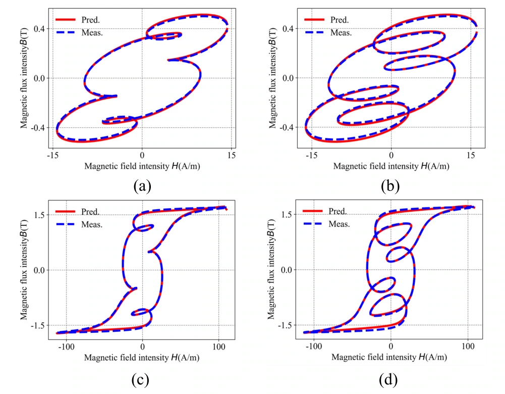

**作者**　张豪、杨庆新、张长庚、李永建、陈怡帆 
**期刊**　IEEE Transactions on Magnetics 60(3), 7300304 (2024) 
**首次在线发表**　2023 年 9 月 18 日 
**刊期**　2024 年 3 月，第 60 卷第 3 期 
**DOI**　`10.1109/TMAG.2023.3316753`

<a href="/assets/papers/2024/recurrent-neural-networks-for-electrical-steel-hysteresis.pdf" download="recurrent-neural-networks-for-electrical-steel-hysteresis.pdf">下载论文全文（PDF）</a> · 4 页 · 5.8 MB

## 研究简介

正弦激励上叠加谐波后，电工钢片的动态磁滞回线会发生变化。研究把 Play 算子与循环神经网络结合，文中谐波工况下总损耗的计算值与实测值误差小于 3%。

## 摘要

为预测复杂激励条件下电工钢片的磁滞特性，本文提出一种基于循环神经网络的 Play 模型。该模型将神经网络与 Play 磁滞算子相结合，用训练得到的神经网络参数结构替代磁滞模型中的分布函数。研究提出基于遗传算法的神经网络超参数自动选择方法，提高了预测精度。实验与模型预测对比表明，所提出的模型可以准确预测材料在正弦和谐波激励下的磁滞特性。

**关键词**　磁滞模型、机器学习、磁特性测量、循环神经网络

<figure style="margin:1.5rem 0">
  
  <figcaption>图 7　四种谐波激励条件下，电工钢片动态磁滞回线的预测值与实测值。 <a href="/assets/papers/2024/recurrent-neural-networks-for-electrical-steel-hysteresis.pdf#page=4">图片所在页</a></figcaption>
</figure>

[英文版](/2023/09/18/recurrent-neural-networks-for-electrical-steel-hysteresis) · [返回团队新闻](/team-news/)
