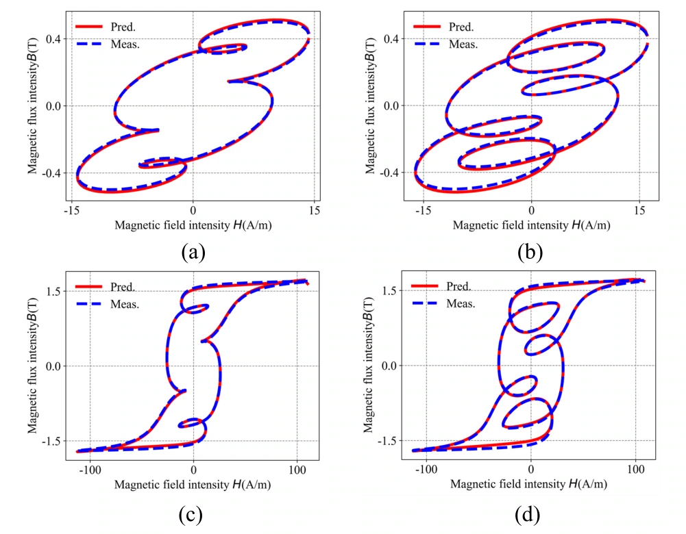

**Authors**　Hao Zhang, Qingxin Yang, Changgeng Zhang, Yongjian Li, Yifan Chen 
**Journal**　IEEE Transactions on Magnetics 60(3), 7300304 (2024) 
**First published online**　18 September 2023 
**Journal issue**　March 2024, volume 60, issue 3 
**DOI**　`10.1109/TMAG.2023.3316753`

<a href="/assets/papers/2024/recurrent-neural-networks-for-electrical-steel-hysteresis.pdf" download="recurrent-neural-networks-for-electrical-steel-hysteresis.pdf">Download full paper (PDF)</a> · 4 pages · 5.8 MB

## Research brief

Harmonics change both the shape and area of the hysteresis loop in electrical steel. In the harmonic tests reported in the paper, the recurrent model predicted total loss with an error below 3%.

## Abstract

In this work, a Play model based on recurrent neural network (RNN) is proposed to predict hysteresis characteristics of electrical steel sheets under complex excitation conditions. The proposed model combines the neural network with the Play hysteresis operator, replacing the distribution function in the hysteresis model with the trained neural network parameter structure. An automatic selection method for neural network hyperparameters based on genetic algorithm (GA) is suggested, which improves the prediction accuracy. Comparing the experimental with the model prediction results, the proposed model can accurately predict the hysteresis characteristics of materials under sinusoidal and harmonic conditions.

**Keywords**　Hysteresis model, machine learning, magnetic characteristic measurement, recurrent neural network (RNN)

<figure style="margin:1.5rem 0">
  
  <figcaption>Figure 7. Predicted and measured dynamic hysteresis loops for the four harmonic excitation cases. <a href="/assets/papers/2024/recurrent-neural-networks-for-electrical-steel-hysteresis.pdf#page=4">Figure in the full paper</a></figcaption>
</figure>

[Chinese edition](/zh/news/recurrent-neural-networks-for-electrical-steel-hysteresis/) · [News of My Group](/categories)
