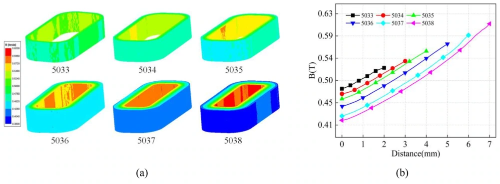

**作者**　孟文斌、张长庚、李永建、孙鹤、万振宇 
**期刊**　AIP Advances 14, 025314 (2024) 
**首次在线发表**　2024 年 2 月 7 日 
**DOI**　`10.1063/9.0000650`

<a href="/assets/papers/2024/high-frequency-loss-in-wound-nanocrystalline-cores.pdf" download="high-frequency-loss-in-wound-nanocrystalline-cores.pdf">下载论文全文（PDF）</a> · 7 页 · 8.1 MB

## 研究简介

卷绕厚度不同，即使磁芯的平均磁通密度相同，局部磁通密度也会有所不同。将这一分布计入损耗分离方程后，不同卷绕厚度试样的平均损耗计算误差控制在 10% 以内。

## 摘要

纳米晶材料具有优良的磁性能，因此纳米晶磁芯广泛用于高频变压器和电感器设计。然而，磁阻与几何形状密切相关，导致磁芯内部的磁通密度分布不均匀，可能使磁芯损耗计算产生较大误差。本文采用有限元方法说明在损耗计算中考虑磁通密度非均匀分布的必要性，提出考虑这一分布的改进损耗分离方程，并通过计算和分析不同卷绕厚度纳米晶磁芯的损耗验证该方程。与传统损耗分离方程相比，改进方程的计算精度有所提高，平均误差控制在 10% 以内。

<figure style="margin:1.5rem 0">
  
  <figcaption>图 3　平均磁通密度为 0.5 T 时，不同卷绕厚度纳米晶磁芯的有限元仿真结果。 <a href="/assets/papers/2024/high-frequency-loss-in-wound-nanocrystalline-cores.pdf#page=4">图片所在页</a></figcaption>
</figure>

[英文版](/2024/02/07/high-frequency-loss-in-wound-nanocrystalline-cores) · [返回团队新闻](/team-news/)
