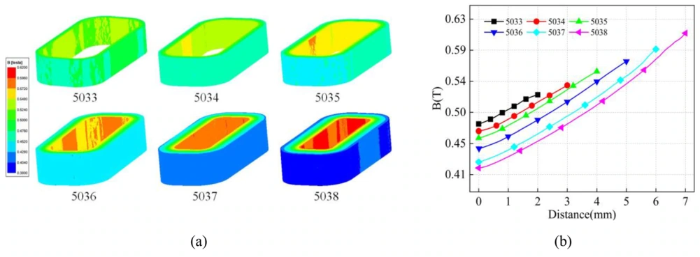

**Authors**　Wenbin Meng, Changgeng Zhang, Yongjian Li, He Sun, Zhenyu Wan 
**Journal**　AIP Advances 14, 025314 (2024) 
**First published online**　7 February 2024 
**DOI**　`10.1063/9.0000650`

<a href="/assets/papers/2024/high-frequency-loss-in-wound-nanocrystalline-cores.pdf" download="high-frequency-loss-in-wound-nanocrystalline-cores.pdf">Download full paper (PDF)</a> · 7 pages · 8.1 MB

## Research brief

Wound cores with the same average flux density can have different local flux distributions. Allowing for that variation brought the average loss-calculation error within 10% for the tested core thicknesses.

## Abstract

Nanocrystalline core is widely used in the design process of high-frequency transformers and inductors due to the attractive magnetic properties of nanocrystalline material. However, the flux density distribution is nonuniform in the core because the reluctance is closely related to its geometric shape. The nonuniformity of flux density distribution may cause huge calculation errors of core losses. In this paper, Finite Element Method (FEM) is used to justify taking into account nonuniform distribution of flux density during the process of core loss calculation. An improved loss separation equation considering nonuniform distribution of flux density is proposed, and the improved equation is verified through calculating and analyzing the losses of nanocrystalline cores with different wound thicknesses. Compared with the traditional loss separation equation, the accuracy is improved, and the average error of improved equation is confined in 10%.

<figure style="margin:1.5rem 0">
  
  <figcaption>Figure 3. Finite-element results for nanocrystalline cores with different winding thicknesses at an average flux density of 0.5 T. <a href="/assets/papers/2024/high-frequency-loss-in-wound-nanocrystalline-cores.pdf#page=4">Figure in the full paper</a></figcaption>
</figure>

[Chinese edition](/zh/news/high-frequency-loss-in-wound-nanocrystalline-cores/) · [News of My Group](/categories)
