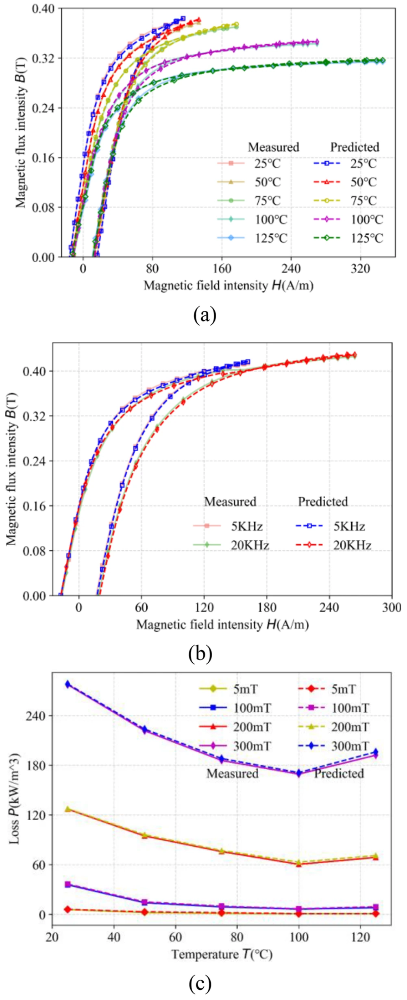

**作者**　张豪、杨庆新、张长庚、李永建、陈怡帆 
**期刊**　AIP Advances 14, 025321 (2024) 
**首次在线发表**　2024 年 2 月 9 日 
**DOI**　`10.1063/9.0000824`

<a href="/assets/papers/2024/temperature-dependent-hysteresis-with-temporal-convolutions.pdf" download="temperature-dependent-hysteresis-with-temporal-convolutions.pdf">下载论文全文（PDF）</a> · 7 页 · 6.1 MB

## 研究简介

团队在 25–125 °C、5–20 kHz 范围内测量了 N87 铁氧体，将自发磁化强度随温度的变化引入模型，以预测不同温度下的回线和损耗。

## 摘要

温度变化会改变铁磁磁芯的磁化行为，进而可能影响电气设备的性能。为准确计算电气设备的电磁特性，有必要建立考虑温度影响的磁滞模型。本文构建了时间卷积网络与 Play 算子相结合的模型，通过将随温度变化的自发磁化强度作为输入来引入温度效应。为提高模型训练结果的准确性，采用贝叶斯优化方法自动选取网络模型参数。结果表明，该模型能够准确预测材料在不同温度和频率条件下的磁滞特性。

<figure style="margin:1.5rem 0">
  
  <figcaption>图 3　不同温度和频率下 N87 铁氧体动态磁滞回线的实测与预测对比，以及 20 kHz 下的磁芯损耗。 <a href="/assets/papers/2024/temperature-dependent-hysteresis-with-temporal-convolutions.pdf#page=6">图片所在页</a></figcaption>
</figure>

[英文版](/2024/02/09/temperature-dependent-hysteresis-with-temporal-convolutions) · [返回团队新闻](/team-news/)
