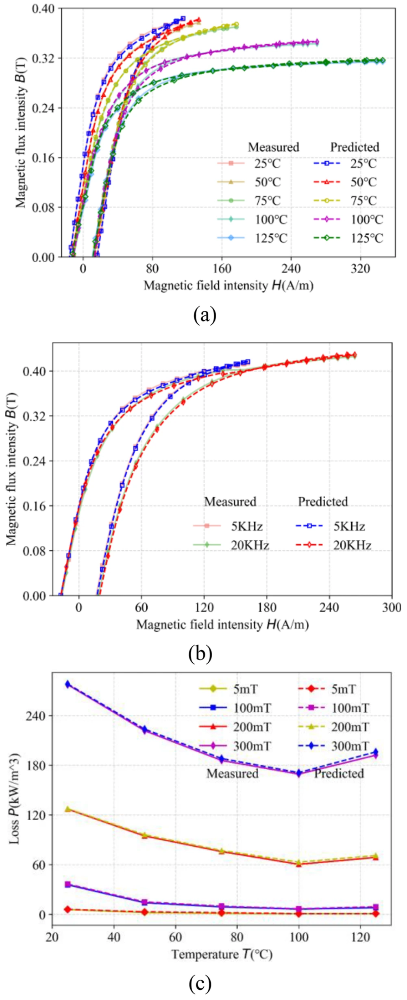

**Authors**　Hao Zhang, Qingxin Yang, Changgeng Zhang, Yongjian Li, Yifan Chen 
**Journal**　AIP Advances 14, 025321 (2024) 
**First published online**　9 February 2024 
**DOI**　`10.1063/9.0000824`

<a href="/assets/papers/2024/temperature-dependent-hysteresis-with-temporal-convolutions.pdf" download="temperature-dependent-hysteresis-with-temporal-convolutions.pdf">Download full paper (PDF)</a> · 7 pages · 6.1 MB

## Research brief

Measurements on N87 ferrite covered 25–125 °C and 5–20 kHz. The model used the temperature dependence of spontaneous magnetization to predict how its hysteresis loops and losses changed.

## Abstract

The variation of temperature modifies the magnetic behavior of ferromagnetic cores which may affect the performance of electrical equipment. Therefore, it is imperative to develop a temperature-dependent hysteresis model to precisely calculate electromagnetic characteristics of electrical equipment. In this paper, a Temporal Convolutional Network (TCN) in combination with the Play operator is developed. The proposed model incorporates the temperature-dependent spontaneous magnetization intensity as the model input to introduce the temperature effect. To enhance the accuracy of model training outcomes, the Bayesian optimization approach for automatically selecting network model parameters is provided. The results show that the proposed model can accurately predict the hysteresis characteristics of materials under varying temperature and frequency conditions.

<figure style="margin:1.5rem 0">
  
  <figcaption>Figure 3. Measured and predicted dynamic loops for N87 ferrite at different temperatures and frequencies, with core losses at 20 kHz. <a href="/assets/papers/2024/temperature-dependent-hysteresis-with-temporal-convolutions.pdf#page=6">Figure in the full paper</a></figcaption>
</figure>

[Chinese edition](/zh/news/temperature-dependent-hysteresis-with-temporal-convolutions/) · [News of My Group](/categories)
