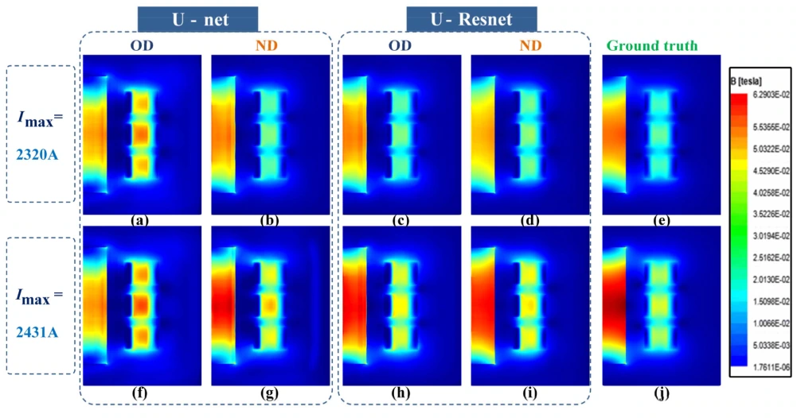

**作者**　陈怡帆、杨庆新、李永建、张豪、张长庚 
**期刊**　IEEE Transactions on Applied Superconductivity 34(8), 5500805 (2024) 
**首次在线发表**　2024 年 6 月 27 日 
**DOI**　`10.1109/TASC.2024.3420184`

<a href="/assets/papers/2024/estimating-transformer-fields-with-deep-convolutional-networks.pdf" download="estimating-transformer-fields-with-deep-convolutional-networks.pdf">下载论文全文（PDF）</a> · 5 页 · 2.1 MB

## 研究简介

用神经网络估算变压器磁场时，研究分别输入磁导率、电导率和励磁电流矩阵，并与仅输入灰度图像的方案对比。预测以二维有限元计算的场分布为参照。

## 摘要

本文以二维有限元分析为基础，研究简化变压器电磁场分布的估算方法。传统神经网络通常以彩色或灰度图像作为输入，这种表示未必适合物理场估算中的稠密回归任务。为此，研究构造了包含物理属性的数据集，将磁导率、电导率和电流激励矩阵作为输入张量的不同通道。通过比较模拟灰度图像的原始数据集和融合不同材料特性的新数据集，分析数据表示对深度学习性能的影响。为进一步提高估算精度，研究提出将 ResNet 残差块与 U-net 结构结合的 U-Resnet 模型，性能比较表明其优于所对比的 U-net。最后提出 Add-RMSE 损失函数，缓解均方误差对少数大误差像素的平均稀释作用，改善反向传播中的梯度传递并进一步提高预测精度。论文通过数值实验验证了这一方法的有效性。

**关键词**　人工神经网络、电磁场、有限元分析

<figure style="margin:1.5rem 0">
  
  <figcaption>图 6　U-net 与 U-ResNet 在不同输入条件下估算的磁场分布及有限元参照结果。 <a href="/assets/papers/2024/estimating-transformer-fields-with-deep-convolutional-networks.pdf#page=4">图片所在页</a></figcaption>
</figure>

[英文版](/2024/06/27/estimating-transformer-fields-with-deep-convolutional-networks) · [返回团队新闻](/team-news/)
