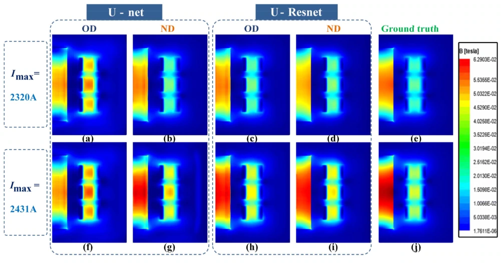

**Authors**　Yifan Chen, Qingxin Yang, Yongjian Li, Hao Zhang, Changgeng Zhang 
**Journal**　IEEE Transactions on Applied Superconductivity 34(8), 5500805 (2024) 
**First published online**　27 June 2024 
**DOI**　`10.1109/TASC.2024.3420184`

<a href="/assets/papers/2024/estimating-transformer-fields-with-deep-convolutional-networks.pdf" download="estimating-transformer-fields-with-deep-convolutional-networks.pdf">Download full paper (PDF)</a> · 5 pages · 2.1 MB

## Research brief

The researchers encoded permeability, conductivity and excitation current in separate input channels and compared them with a grayscale representation. Two-dimensional finite-element solutions provided the reference fields.

## Abstract

This paper aims to estimate the electromagnetic field distribution in a simplified transformer through two-dimensional (2-D) finite element analysis. Traditional neural networks typically take RGB or grayscale image as inputs, which may not be optimal for dense regression tasks encountered in physics field estimations. To address this, we propose a novel approach that constructs datasets incorporating meaningful physical properties, such as magnetic permeability, conductivity and current excitation matrices, as different channels in the input tensors. Specifically, we compare two datasets: the original dataset (OD) simulating grayscale images and the new dataset (ND) integrating distinct material characteristics. This comparative analysis allows us to investigate the impact of different datasets on deep learning performance. Furthermore, to enhance estimation accuracy, we introduce the U-Resnet model, a hybrid architecture combining ResNet’s residual blocks with the U-net structure. By comparing the performances of U-net and U-Resnet, we demonstrate the superiority of the latter. Finally, we propose the Add-RMSE loss function, which mitigates the weakening effect of averaging large error pixels when using MSE as the loss function. This enhancement improves gradient propagation during backpropagation and further enhances prediction accuracy. The effectiveness of our proposed method is validated through comprehensive numerical experiments.

**Keywords**　Artificial neural network, electromagnetic fields, FEA

<figure style="margin:1.5rem 0">
  
  <figcaption>Figure 6. Field distributions estimated by U-net and U-ResNet for different inputs, alongside the finite-element reference. <a href="/assets/papers/2024/estimating-transformer-fields-with-deep-convolutional-networks.pdf#page=4">Figure in the full paper</a></figcaption>
</figure>

[Chinese edition](/zh/news/estimating-transformer-fields-with-deep-convolutional-networks/) · [News of My Group](/categories)
