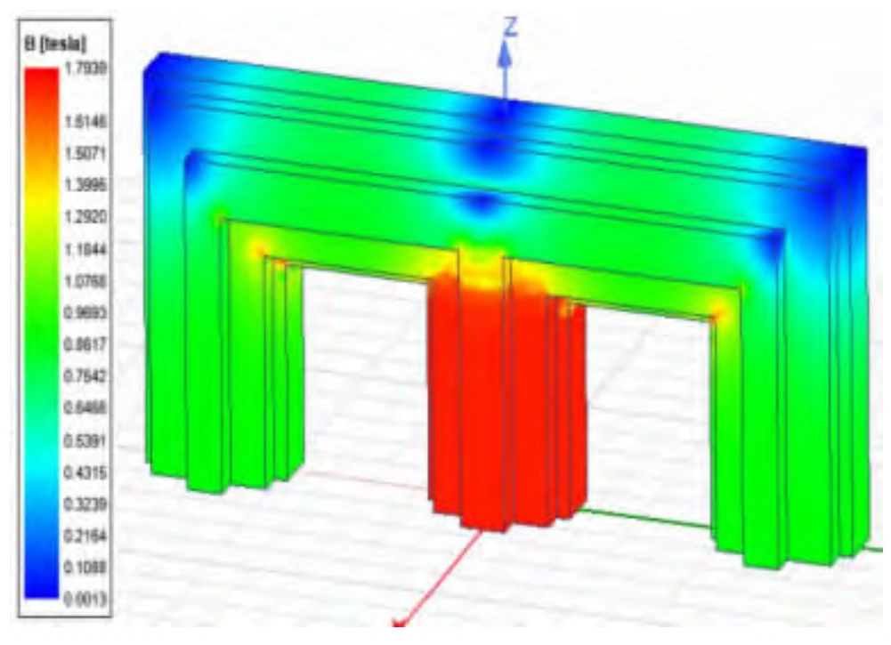

**作者**　张长庚、王锴、王春光、万振宇 
**期刊**　《变压器》第 61 卷第 10 期，第 1–5 页（2024） 
**刊期**　2024 年 10 月 
**DOI**　`10.19487/j.cnki.1001-8425.2024.10.010`

<a href="/assets/papers/2024/optimal-design-of-hybrid-laminated-transformer-cores.pdf" download="optimal-design-of-hybrid-laminated-transformer-cores.pdf">下载论文全文（PDF）</a> · 5 页 · 0.3 MB

## 研究简介

同一个铁心里，两种电工钢怎样排列会影响磁通分布。论文用三维瞬态仿真比较了多种方案，给出了常规取向钢与高磁导率电工钢的位置对损耗的影响。

## 摘要

电力变压器是电力系统中的关键设备，对整个电力系统中发电和电能传送具有重要作用。变压器铁心的损耗与内部磁通密度的分布息息相关，采用混合叠片结构可以有效减少铁心叠片库存，提高变压器铁心叠片的利用率。本文作者利用 ANSYS Maxwell 软件对不同类型叠片混合的变压器铁心进行了三维瞬态电磁场模拟仿真，分析了采用不同类型叠片混合时铁心的磁通密度和损耗差异。研究结果显示，当铁心的最内层叠片采用常规晶粒取向电工钢，其余叠片采用高磁导率电工钢时，铁心的损耗最小；随着在高磁导率电工钢铁心主体中加入常规晶粒取向电工钢叠片，铁心损耗的增幅达到了 14.9%~49.4%。本文的研究成果可为变压器铁心的优化设计提供一定的依据。

**关键词**　电力变压器、混合叠片、铁心损耗

<figure style="margin:1.5rem 0">
  
  <figcaption>图 3　混片铁心三维模型的磁通密度分布。 <a href="/assets/papers/2024/optimal-design-of-hybrid-laminated-transformer-cores.pdf#page=3">图片所在页</a></figcaption>
</figure>

[英文版](/2024/10/optimal-design-of-hybrid-laminated-transformer-cores) · [返回团队新闻](/team-news/)
