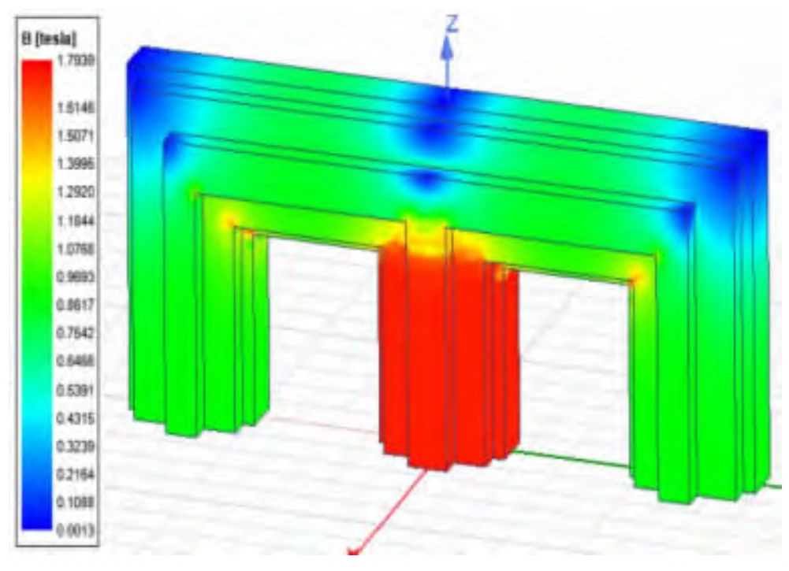

**Authors**　Changgeng Zhang, Kai Wang, Chunguang Wang, Zhenyu Wan 
**Journal**　Transformer 61(10), 1–5 (2024) 
**Issue date**　October 2024 
**DOI**　`10.19487/j.cnki.1001-8425.2024.10.010`

<a href="/assets/papers/2024/optimal-design-of-hybrid-laminated-transformer-cores.pdf" download="optimal-design-of-hybrid-laminated-transformer-cores.pdf">Download full paper (PDF)</a> · 5 pages · 0.3 MB

## Research brief

Moving a steel grade from one layer of a transformer core to another changes the flux distribution. The authors compared several arrangements in three-dimensional transient simulations to identify the lower-loss configuration.

## Abstract

Power transformer is regarded as a key link in the power system, and plays an important role in power generation and power transmission in the whole power system. The loss of transformer core is closely related to the distribution of internal magnetic flux density, and the use of hybrid laminated structure can effectively reduce the number of core laminations and improve the operational efficiency of the transformer. In this study, three-dimensional transient electromagnetic field simulations of transformer cores mixed with different types of laminations are carried out using ANSYS Maxwell software to analyze the magnetic flux density and losses of the core when mixed with different types of laminations. The results show that the core loss is minimized when the inner layer of the core is made of conventional grain-oriented electrical steel and the rest of the stacks are made of high-permeability electrical steel, and the increase in core loss reaches 14.9% ~49.4% with the addition of conventional grain-oriented electrical steel stacks to the main body of the core made of high-permeability electrical steel. The research results of this paper can provide some basis for the optimized design of transformer cores.

**Keywords**　Power transformer, hybrid lamination, core loss

<figure style="margin:1.5rem 0">
  
  <figcaption>Figure 3. Flux-density distribution in the three-dimensional model of the laminated transformer core. <a href="/assets/papers/2024/optimal-design-of-hybrid-laminated-transformer-cores.pdf#page=3">Figure in the full paper</a></figcaption>
</figure>

[Chinese edition](/zh/news/optimal-design-of-hybrid-laminated-transformer-cores/) · [News of My Group](/categories)
