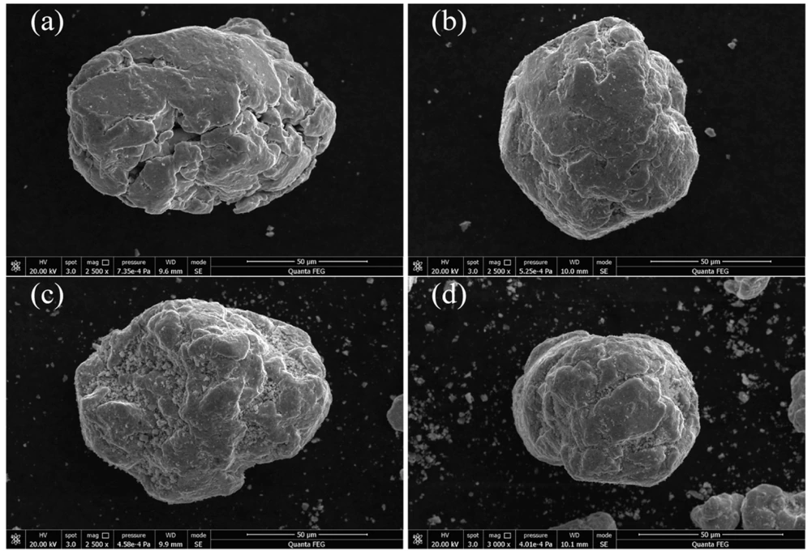

**作者**　张长庚、郭子冉、林志伟、李永建 
**期刊**　Journal of Alloys and Compounds 1012, 178436 (2025) 
**首次在线发表**　2025 年 1 月 1 日 
**DOI**　`10.1016/j.jallcom.2024.178436`

<a href="/assets/papers/2025/low-pressure-sintering-of-iron-ferrite-powder-cores.pdf" download="low-pressure-sintering-of-iron-ferrite-powder-cores.pdf">下载论文全文（PDF）</a> · 10 页 · 13.2 MB

## 研究简介

在四种镍锌铁氧体配比中，添加量为 2.5 wt% 的样品在 20–200 kHz 范围内取得了较好的综合磁性能。

## 摘要

由绝缘包覆层和软磁粉末基体组成的软磁复合材料有望拓宽电磁设备的工作频率范围并提高能量转换效率。工业和科研均需要能够缩短制备时间、降低成本的工艺。本研究设计了一种低压放电等离子烧结方法，制得的软磁复合材料比文中对比的高压工艺样品具有更好的磁性能。采用高电阻率镍锌铁氧体包覆纯铁粉末，制备了四种不同铁氧体含量的样品。利用扫描电子显微镜检查包覆完整性，综合测量其力学、电学和磁学性能，并建立损耗分离模型，评价 20–200 kHz 下的磁性能。不同含量样品的比较表明，镍锌铁氧体有助于提高磁导率和饱和磁化强度，并降低剩磁和矫顽力。对本次考察的纯铁粉末基复合材料，2.5 wt% 是适用于该频段的最优铁氧体含量。

<figure style="margin:1.5rem 0">
  
  <figcaption>图 3　四种镍锌铁氧体质量分数下，球磨后复合粉末的表面形貌。 <a href="/assets/papers/2025/low-pressure-sintering-of-iron-ferrite-powder-cores.pdf#page=3">图片所在页</a></figcaption>
</figure>

[英文版](/2025/01/04/paper-guoziran) · [返回团队新闻](/team-news/)
