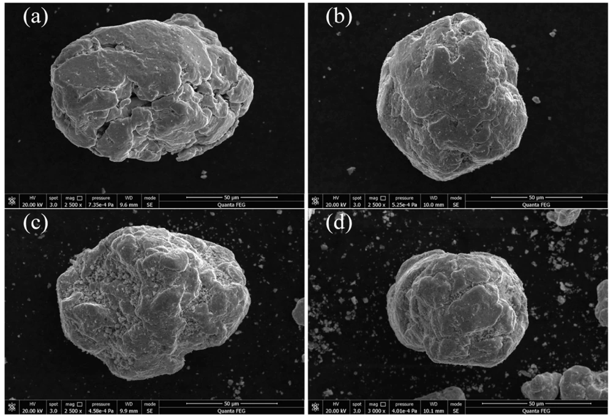

**Authors**　Changgeng Zhang, Ziran Guo, Zhiwei Lin, Yongjian Li 
**Journal**　Journal of Alloys and Compounds 1012, 178436 (2025) 
**First published online**　1 January 2025 
**DOI**　`10.1016/j.jallcom.2024.178436`

<a href="/assets/papers/2025/low-pressure-sintering-of-iron-ferrite-powder-cores.pdf" download="low-pressure-sintering-of-iron-ferrite-powder-cores.pdf">Download full paper (PDF)</a> · 10 pages · 13.2 MB

## Research brief

Of four ferrite contents tested, 2.5 wt% gave the best overall magnetic performance in the iron powder cores at 20–200 kHz.

## Abstract

Soft magnetic composites (SMCs) comprising an insulation coating and a soft magnetic powder matrix have the potential to extend the application frequency range of electromagnetic equipment and improve energy conversion efficiency. Producing high-performance SMCs in less time and low cost is highly demanded by industry and research. In this paper, a novel low-pressure spark plasma sintering (SPS) technique is designed to prepare SMCs, which have superior magnetic properties than those prepared by high-pressure methods. High-resistivity Ni-Zn ferrite is used to coat the pure iron powder matrix, and four SMCs with varying ferrite contents are prepared. Their structural characteristics of coating completeness are verified by SEM, and their mechanical, electrical, and magnetic properties are investigated comprehensively. A loss separation model for SMCs is established for evaluating the magnetic properties at high-frequency (20–200 kHz). The influences of the Ni-Zn ferrite content on the magnetic properties are compared based on experiments of various SMCs samples. The magnetic properties experiments indicates that the Ni–Zn ferrite contributed to the improvement of magnetic properties, including high permeability, saturation magnetization, and low remanence and coercivity. The study finds that 2.5 wt% Ni-Zn ferrite is the optimal percentage for producing pure iron powder matrix SMCs suitable for applications in the 20–200 kHz frequency range.

<figure style="margin:1.5rem 0">
  
  <figcaption>Figure 3. Surface morphology of the milled composite powders at four ferrite contents. <a href="/assets/papers/2025/low-pressure-sintering-of-iron-ferrite-powder-cores.pdf#page=3">Figure in the full paper</a></figcaption>
</figure>

[Chinese edition](/zh/news/low-pressure-sintering-of-iron-ferrite-powder-cores/) · [News of My Group](/categories)
