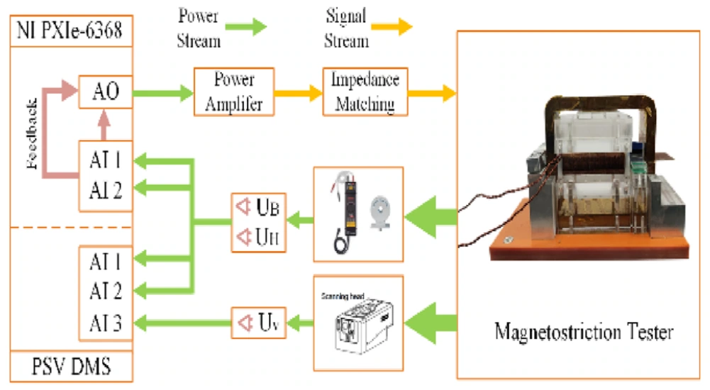

**Authors**　Changgeng Zhang, Haitao Zhang, Tao Chen, Yongjian Li 
**Journal**　AIP Advances 15, 035207 (2025) 
**First published online**　5 March 2025 
**DOI**　`10.1063/9.0000878`

<a href="/assets/papers/2025/medium-frequency-magnetostriction-of-nanocrystalline-laminations.pdf" download="medium-frequency-magnetostriction-of-nanocrystalline-laminations.pdf">Download full paper (PDF)</a> · 6 pages · 5.9 MB

## Research brief

Between 1 and 10 kHz, the hysteresis loops widened, while peak-to-peak magnetostriction first rose and then fell. The measured strain also changed from elongation to contraction.

## Abstract

Nanocrystalline alloys, widely used as core materials of medium-frequency transformers, require accurate measurement of their magnetostriction to calculate the core vibration and noise during the transformer design phase. A synchronous measuring system consisting of a magnetizer with an optical reflector and a laser vibrometer is constructed to measure the 1D magnetic loss and magnetostriction properties under medium-frequency excitation. The annealed nanocrystalline alloy sheets are laminated and measured in this study due to their softness and brittleness. The influence of single- and double-yoke magnetic circuit structures on the measurement of magnetic properties is discussed. The hysteresis loops and magnetostriction of nanocrystalline alloy laminations with a double-yoke structure are measured from 1 kHz to 10 kHz. The results indicate that the hysteresis loops widen as the frequency increases, resulting in increased losses. Moreover, the peak-to-peak value of magnetostriction first increases and then decreases with increasing excitation frequency, and the magnetostriction curves exhibit a transition from elongation to contraction. These results can provide data support for the design of cores for medium-frequency electromagnetic devices.

<figure style="margin:1.5rem 0">
  
  <figcaption>Figure 3. System for synchronous magnetic and magnetostriction measurements of nanocrystalline laminations. <a href="/assets/papers/2025/medium-frequency-magnetostriction-of-nanocrystalline-laminations.pdf#page=4">Figure in the full paper</a></figcaption>
</figure>

[Chinese edition](/zh/news/medium-frequency-magnetostriction-of-nanocrystalline-laminations/) · [News of My Group](/categories)
