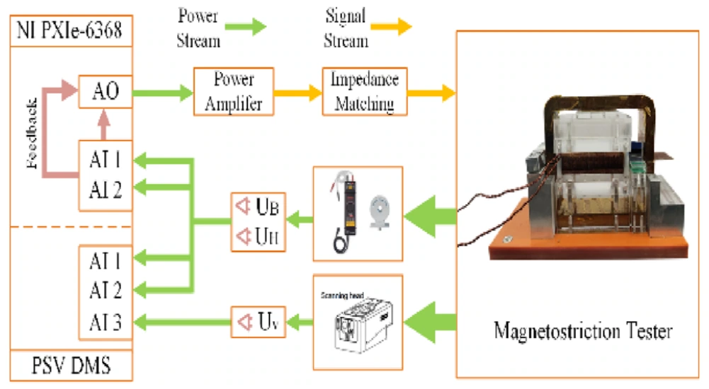

**作者**　张长庚、张海涛、陈涛、李永建 
**期刊**　AIP Advances 15, 035207 (2025) 
**首次在线发表**　2025 年 3 月 5 日 
**DOI**　`10.1063/9.0000878`

<a href="/assets/papers/2025/medium-frequency-magnetostriction-of-nanocrystalline-laminations.pdf" download="medium-frequency-magnetostriction-of-nanocrystalline-laminations.pdf">下载论文全文（PDF）</a> · 6 页 · 5.9 MB

## 研究简介

从 1 kHz 升至 10 kHz，纳米晶叠片的磁滞回线逐渐变宽，磁致伸缩峰峰值却先升后降，测得的形变还出现了由伸长向收缩的转变。

## 摘要

纳米晶合金广泛用于中频变压器铁心，设计阶段计算铁心振动与噪声需要准确测量其磁致伸缩。研究构建了由带光学反射器的励磁装置和激光测振仪组成的同步测试系统，用于测量一维中频激励下的磁损耗与磁致伸缩。退火后的纳米晶合金片柔软且易碎，因此采用叠片试样。研究讨论了单磁轭与双磁轭磁路结构对磁特性测试的影响，并利用双磁轭结构在 1–10 kHz 下测量磁滞回线及磁致伸缩。结果表明，频率增大时磁滞回线变宽，损耗增加。磁致伸缩峰峰值随频率先增大后减小，曲线呈现由伸长向收缩的转变。这些实测数据可用于中频电磁设备铁心设计。

<figure style="margin:1.5rem 0">
  
  <figcaption>图 3　同步测量纳米晶叠片磁特性与磁致伸缩的系统。 <a href="/assets/papers/2025/medium-frequency-magnetostriction-of-nanocrystalline-laminations.pdf#page=4">图片所在页</a></figcaption>
</figure>

[英文版](/2025/01/09/AIP-haitao) · [返回团队新闻](/team-news/)
